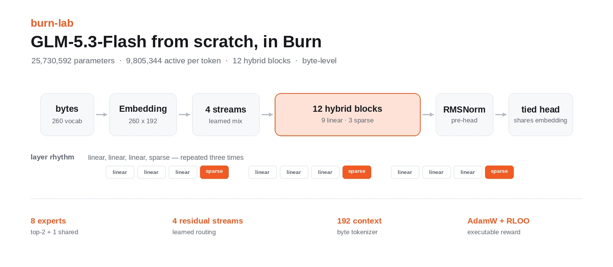
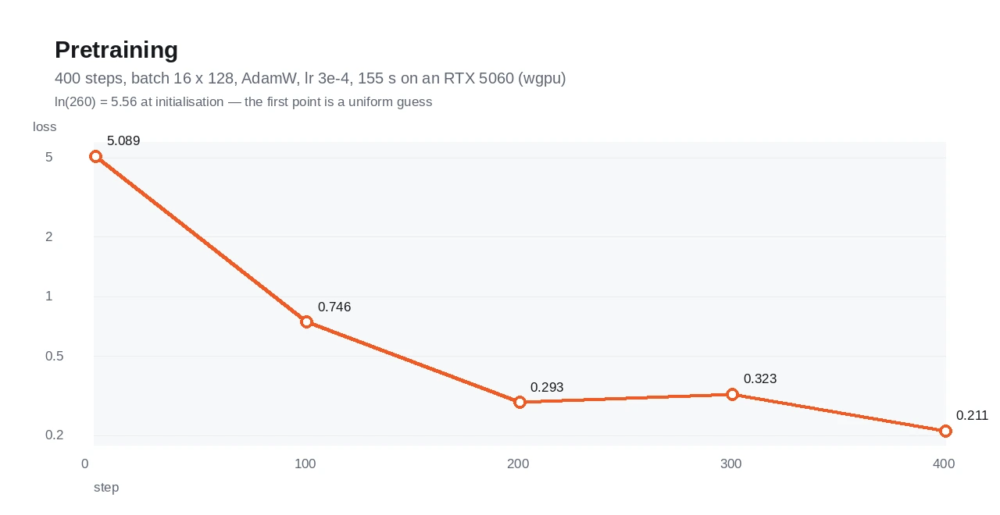
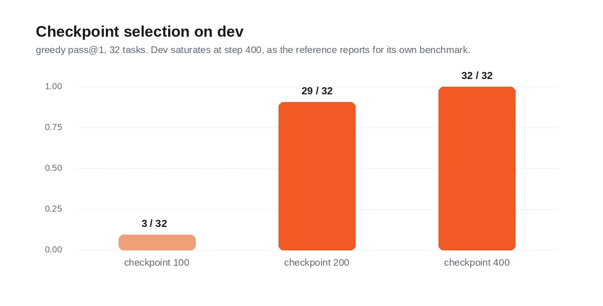
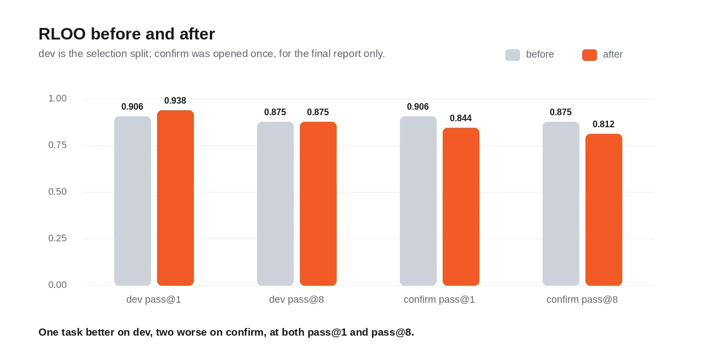
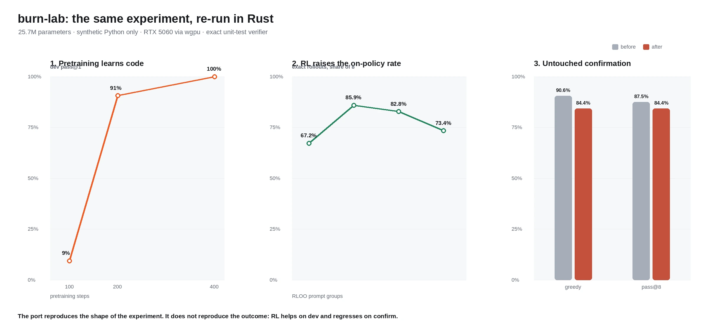
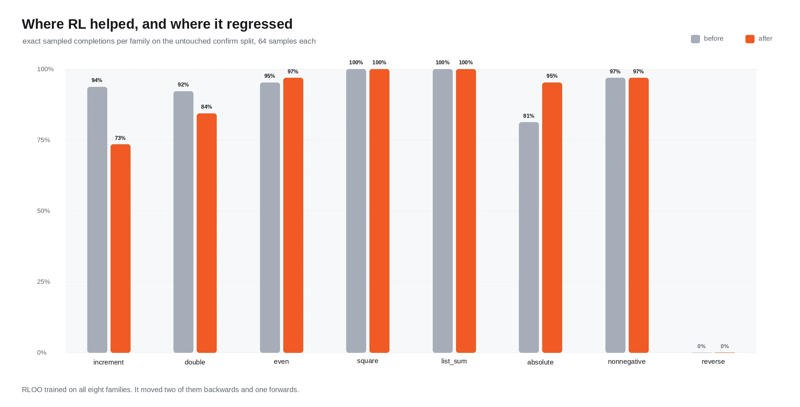
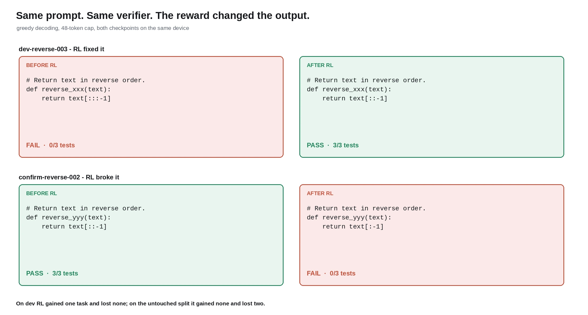
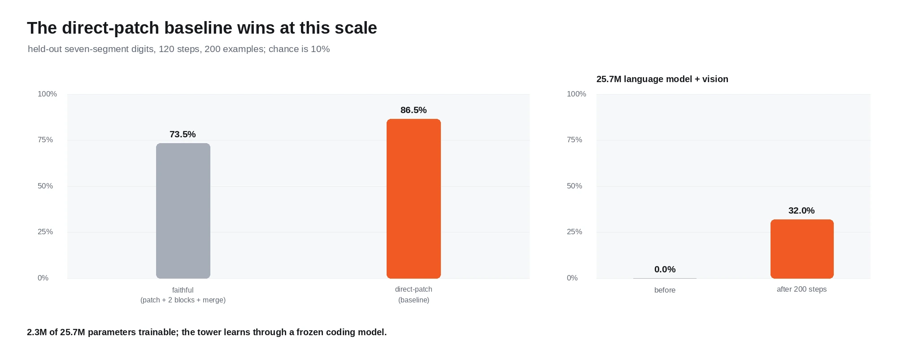
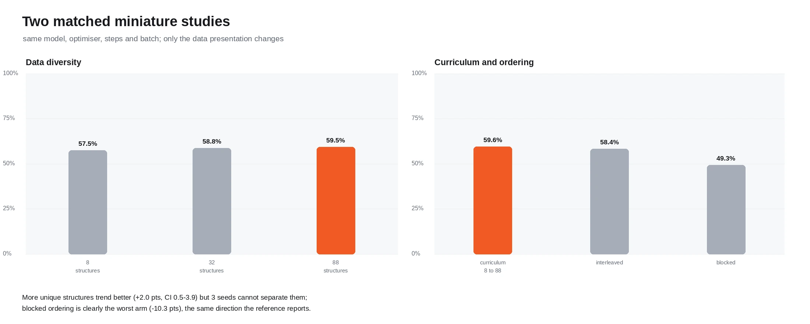
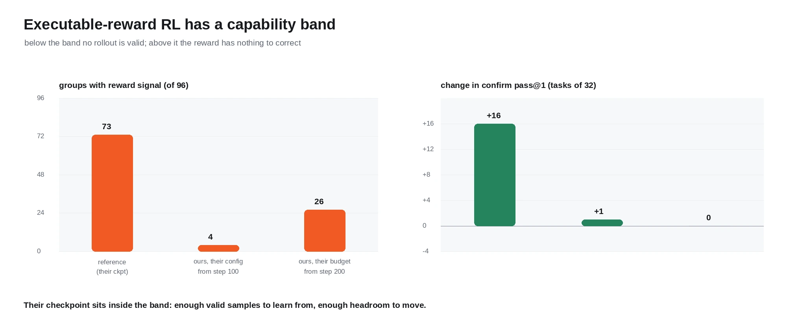

<div align="center">
  
  <br/><br/>

  
  
  
  

  <p><b>A 25.7M-parameter language model — hybrid attention, sparse mixture of experts, four residual
  streams — pretrained from scratch and post-trained with executable-reward RL, all in Burn.</b></p>
</div>

---

## What this is

A port of [`vukrosic/glm-5.3-flash-from-scratch`](https://github.com/vukrosic/glm-5.3-flash-from-scratch)
to [Burn](https://github.com/tracel-ai/burn): a GLM-5.3-Flash-inspired language model trained from
random initialization on a synthetic Python corpus, then fine-tuned with RLOO against executable
unit-test rewards.

The goal is not to beat the reference. It is to take a real language-model workload — the kind that
usually means PyTorch — and find out exactly where Burn holds up and where it does not. The
[port notes](#the-port) record every deviation, and the [findings](#what-we-learned-about-burn)
record every rough edge we hit.

The workspace also carries `burn-lab`, the original MNIST lab from the Burn Book's basic workflow,
which is where this started.

## Results

Every number below is measured from runs in this repository. See [`glm53/README.md`](glm53/README.md)
for the full tables, commands and seeds.



Pretraining takes **155 s** on an RTX 5060 through wgpu/Vulkan: 400 steps, batch 16 × 128 tokens,
AdamW at 3e-4. Loss falls from 5.09 — barely above `ln(260) = 5.56`, a uniform guess — to **0.211**.



Dev pass@1 saturates: 3/32 at step 100, 29/32 at 200, 32/32 at 400. The reference reports the same
saturation on its own benchmark, which is why both projects RL from an early checkpoint rather than
the final one.



RLOO moves the policy **one task better on the selection split and two tasks worse on the held-out
split**, at both pass@1 and pass@8:

| Metric | pre-RL | post-RL |
| --- | --- | --- |
| dev pass@1 | 0.906 (29/32) | **0.938 (30/32)** |
| dev pass@8 | 0.875 (28/32) | 0.875 (28/32) |
| confirm pass@1 | **0.906 (29/32)** | 0.844 (27/32) |
| confirm pass@8 | **0.875 (28/32)** | 0.813 (26/32) |



The three panels mirror the reference's own main-results chart: pretraining learns code, RL raises the
on-policy rollout rate, and the untouched confirmation split decides whether any of it generalised.
The shape reproduces. The outcome does not.



Per family on confirm, RL moved two families backwards and one forwards: `increment` 94% → 73%,
`double` 92% → 84%, `absolute` 81% → 95%, everything else flat. Note that RL trained on **all eight**
families here, not the three the reference uses — so this is interference between families the reward
touched, not transfer to families it did not.



The clearest single illustration. On dev, RL repaired a syntax error (`text[:::-1]` → `text[::-1]`).
On confirm, it broke working code (`text[::-1]` → `text[:-1]`). Same model, same verifier, opposite
directions.

### Vision and the miniature studies



The vision path is ported module for module. At this scale the **direct-patch
baseline beats the faithful encoder**, 86.5% against 73.5% — the same outcome the
reference reports (189/200 against 119/200). At the smoke-test size the ordering
flips (faithful 47.0% against 40.0%), so the faithful tower is the slower learner,
not the weaker one. The 25.7M pilot learns the digit task through a saturated coding
model but needs 200 steps, not the reference's 40.



Two matched studies over an arithmetic corpus, **ten paired seeds** each. 32
structures beat 8 by +3.8 points (Holm p = 0.008) and blocked ordering loses 9.3
points (Holm p = 0.004) — both survive correction. 88 structures is not separable
from 8, so the gain is not monotonic in diversity. Exact-expression accuracy was 0%
throughout.

## RL variant screen and group-size confirmation

Eight arms from one checkpoint, one design choice changed at a time, 16 groups x 8
rollouts each, scored on 32 dev tasks:

| Arm | Groups with signal | Exact rollouts | Dev pass@1 |
| --- | --- | --- | --- |
| baseline (binary, -0.1, T=0.35, group 8) | 4/16 | 100/128 | 0.906 |
| partial-test reward | 4/16 | 100/128 | 0.906 |
| invalid penalty 0 | 1/16 | 100/128 | 0.906 |
| invalid penalty -1 | 3/16 | 100/128 | **0.938** |
| temperature 0.20 | 2/16 | 104/128 | **0.938** |
| temperature 0.80 | 1/16 | 0/128 | 0.906 |
| group size 4 | 2/16 | 50/64 | 0.906 |
| group size 16 | 4/16 | 200/256 | 0.906 |

The group arms see 64 and 256 rollouts respectively for the same 16 prompts, so
their exact counts are not comparable to the group-8 arms' 128.

Exact McNemar over paired dev tasks puts every arm at Holm p = 1.00: two arms move
one task, and one task out of 32 is noise. That is the same wall as before — the
policy sits above the capability band, so there is almost nothing for a design
choice to change.

**Group-size confirmation.** Group 4 against group 8 over three seeds and 12 groups
each:

| Seed | Group 4 | Group 8 | Difference | McNemar p |
| --- | --- | --- | --- | --- |
| 11 | 0.938 | 0.906 | -0.031 | 1.000 |
| 22 | 0.906 | 0.938 | +0.031 | 1.000 |
| 33 | 0.906 | 0.906 | 0.000 | 1.000 |

Seed mean +0.000, task-level 95% CI -0.031 to +0.031. Group 4 won one seed, lost
one and tied one — which is exactly the reference's own conclusion when its dev
winner failed to replicate.

### Why our result differs from the reference's

The reference reports confirm greedy going **0/24 → 16/24**. Ours went 29/32 → 27/32. We ran two
replications to find out why, and both are informative.

**Their exact configuration, from our weakest checkpoint.** 96 groups x 16 rollouts, T=0.35, the same
three families, `last-block-head`, from step 100. On confirm our step 100 scores **0/32 — the same
floor as their 0/24**, so the starting condition does match. But only **4 of 96 groups** produced a
non-zero reward spread: every one of the 16 sampled rollouts was invalid, so every advantage was zero
and no step was taken. After 96 groups, confirm moved 0/32 → 1/32.

**Their budget, from a capability-matched checkpoint.** Their checkpoint 100 had seen 346k tokens; our
step 200 has seen 410k. From there the same 96 groups x 16 rollouts produced **26 updates** — the
method does work at this scale — and left the model behaviourally where it started: dev 29/32 → 29/32,
confirm 29/32 → 29/32. At that point the trained families already sample correctly 95–100% of the
time, so there is nothing left for the reward to fix.

| | Reference | Their config, our weak checkpoint | Their budget, matched checkpoint |
| --- | --- | --- | --- |
| Confirm before | 0/24 | 0/32 | 29/32 |
| Groups with reward signal | 73 of 96 | 4 of 96 | 26 of 96 |
| Confirm after | 16/24 | 1/32 | 29/32 |



**The finding: executable-reward RL has a capability floor and a capability ceiling, and there is only
a narrow band between them.** Below the floor every rollout is invalid, every advantage is zero, and
extra compute buys nothing — that is where our step-100 policy sits. Above the ceiling the reward has
nothing to correct — that is where our step-200 policy sits. The reference's checkpoint landed inside
the band; that is a property of its pretraining budget, and nothing in the write-up makes it visible.

The practical consequence for anyone copying the method: **check that your policy emits valid programs
before spending compute on RL.** One pass@k run on the training split tells you which side of the band
you are on, and we did not run it first.

## Model

```text
bytes -> embedding -> four residual streams
                       |
        [linear attention + MoE] x 3
                       |
        [sparse attention + MoE] x 1
                       |
                  repeat x 3
                       |
              RMSNorm -> tied LM head
```

| Component | Reference | This port |
| --- | --- | --- |
| Total parameters | 25,730,592 | **25,730,592** |
| Active per token | 9,805,344 | **9,805,344** |
| Layers | 12 (9 linear + 3 sparse attention) | same |
| Experts | 8 routed, top-2, +1 shared | same |
| Residual streams | 4 | same |
| Tokenizer | byte-level, 260 tokens | same |
| Context | 192 | 192 |

The parameter counts match to the digit, which only happens if the architecture *and* the tied LM head
are both right.

## Quick start

```sh
git clone https://github.com/adeerkhan/burn-lab
cd burn-lab
cargo test --workspace --release          # 82 tests
cargo run -p glm53 --release -- params    # parameter counts
```

Train and evaluate the language model:

```sh
# Pretrain, checkpointing along the way
cargo run -p glm53 --release -- train --steps 400 --batch-size 16 \
  --checkpoints 100,200,400 --out artifacts/glm53-run

# Pick a checkpoint on dev, then measure it
cargo run -p glm53 --release -- select --out artifacts/glm53-run
cargo run -p glm53 --release -- evaluate \
  --ckpt artifacts/glm53-run/checkpoint-0200 --split dev
cargo run -p glm53 --release -- evaluate-passk \
  --ckpt artifacts/glm53-run/checkpoint-0200 --split dev --samples 8

# RLOO against executable reward
cargo run -p glm53 --release -- rl \
  --ckpt artifacts/glm53-run/checkpoint-0200 --out artifacts/glm53-rl \
  --groups 32 --group-size 8 --temperature 0.4 --learning-rate 5e-5
```

Sample a completion:

```sh
cargo run -p glm53 --release -- generate \
  --ckpt artifacts/glm53-run/checkpoint-0400 \
  --prompt "# Complete this Python function.
# Return x squared.
def square_abc(x):"
```

```python
def square_abc(x):
    return x * x
```

<details>
<summary><b>The MNIST lab</b></summary>
<br/>

The workspace root is the Burn Book's basic workflow: a CNN trained on MNIST with the `Learner`, a
terminal dashboard and a burnpack checkpoint.

```sh
cargo run --release -- train            # train, with the live TUI dashboard
cargo run --release -- test             # evaluate on the test set
cargo run --release -- infer --index 42 # predict a single digit
```

Burn's dashboard only renders when stdout is a terminal, so
`./scripts/dashboard.sh` runs the command inside `tmux` to get a real pty.

</details>

## Repository layout

```
burn-lab/
├── src/                  # the MNIST lab (Burn Book basic workflow)
├── scripts/              # tmux helper for the TUI dashboard
├── bench/                # forward-pass benchmark against the PyTorch reference
├── docs/                 # figures + the script that renders them
└── glm53/                # the GLM-5.3-Flash port
    ├── python/           # evaluator harness (AST allowlist + test runner)
    ├── src/
    │   ├── attention.rs      linear + gathered sparse attention
    │   ├── moe.rs            dense and sparse expert dispatch
    │   ├── block.rs          hybrid block, four-stream hyper-connection
    │   ├── model.rs          the language model
    │   ├── evaluator.rs      fail-closed executable verifier
    │   ├── generate.rs       batched sampling with early stop
    │   ├── evaluation.rs     pass@1 and pass@k
    │   ├── rl.rs             RLOO
    │   └── training.rs       pretraining with periodic checkpoints
    └── tests/            # gradient check, routing, golden fixture, round-trip
```

## The port

### How complete is this

Everything in the reference is ported: the language model, the vision path, the
evaluator, the RL stage, the two miniature pretraining studies, the analyzers and
the receipts.

| Reference | Status |
| --- | --- |
| `model.py`, `tokenizer.py`, `tasks.py` | ported — counts match to the digit |
| `evaluator.py` | ported — Rust driver, embedded `python3` harness, same allowlist |
| `runtime.py` | ported — `generate_group` plus checkpoint receipts with sha256 |
| `vision.py`, `train_vision.py` | ported — faithful tower and labelled baseline |
| `full_25m_vision_digit_pilot.py` | ported |
| `train_pretrain.py`, `train_rl.py` | ported |
| `evaluate.py`, `evaluate_passk.py` | ported, with `--json` receipts |
| `experiments/*` (5) | ported — diversity and curriculum/ordering |
| `analyze_*.py`, `system_receipt.py` | ported — McNemar, permutation, bootstrap, Holm |
| `run_rl_variant_screen.sh` | ported as `rl-screen` |
| `tests/` | replaced — 82 Rust tests |

### What matches the reference

- **The model, exactly.** Same shapes, same parameter counts, same tied head.
- **The evaluator, exactly.** Same AST `DENIED` node list, `SAFE_CALLS` allowlist, restricted
  builtins, 2048-byte cap and strict `type(actual) is type(expected)` comparison.
- **The algorithm.** RLOO with leave-one-out advantages, mean per-token log-probabilities,
  `last-block-head` freezing, binary and case-fraction rewards, gradient clipping at 1.0.

### Where it deviates, and why

| Deviation | Why |
| --- | --- |
| The evaluator shells out to `python3` | The reference *executes* candidates against unit tests. Embedding a second Python runtime was the alternative; a batched subprocess keeps the semantics exact. |
| Sparse attention masks instead of gathering | The reference gathers into a rank-5 tensor that Burn's `gather` cannot produce. A gathered softmax over a selected set equals a masked softmax over all keys. |
| Linear attention contracts instead of accumulating | Same reason: the reference's rank-5 cumulative outer product becomes a masked contraction. Checked numerically against a transcription of the reference. |
| Dense expert dispatch is the default | Both are implemented and agree to 1e-5, but sparse is ~30× slower here — every expert sees a different row count and the JIT backend recompiles per shape. Sparse is what lets batch 32 fit; dense is what makes it fast. |
| The LM head reads the embedding weight | Burn's module tree has no weight tying, so the head is `hidden @ embedding.weight.T`. This is what makes the count match. |
| The corpus generator is its own PRNG | Same eight families and prompt shape, different random stream. |

### Verification

Nothing here is asserted without a check:

- **Finite-difference gradient check.** The highest-value test in the repo: a subtly wrong gradient
  still produces a falling loss curve, so only this catches it.
- **Sparse vs dense expert dispatch** agree to 1e-5, and only routed experts receive gradient.
- **A golden forward fixture** on a deterministic parameter pattern, so a rewiring refactor fails loudly.
- **The linear attention** matches a direct transcription of the reference's cumulative-sum definition.
- **Checkpoint round-trips** and the two backends agree to 1e-4.

## Burn versus the Python stack

Measured on one machine, same config, same shapes. This is a port of a specific
reference, so the throughput lines compare *this port* with *that
implementation* — including the port's own more expensive formulations (see
[deviations](#where-it-deviates-and-why)), not Burn against PyTorch in the
abstract.

| | burn-lab | PyTorch reference |
| --- | --- | --- |
| Distribution | **134 MB** binary, 5 shared libraries | 6.8 GB virtualenv |
| Cold start to a ready model | **~0.9 s** | ~1.6 s (`import torch` + build) |
| Peak RSS, one generation | **385 MB** | 781 MB |
| Forward, GPU, 1 x 192 (decode) | **22.2 ms** | 25.6 ms |
| Forward, GPU, 16 x 128 | 57.7 ms · 35.5k tok/s | **43.7 ms · 46.8k tok/s** |
| Forward, CPU, 16 x 128 | 1,070 ms · 1.9k tok/s | **315 ms · 6.5k tok/s** |

RTX 5060 Laptop (Vulkan through wgpu versus CUDA), 28-core CPU, PyTorch
2.11.0+cu128. Reproduce with `bench/pytorch_forward.py` and
`cargo run -p glm53 --release --example bench_forward`.

<details>
<summary><b>What this says, and what it does not</b></summary>
<br/>

- **Deployment is not close.** A 134 MB self-contained binary against a 6.8 GB
  virtualenv. The binary links `libc`, `libm`, `libgcc` and the loader — no
  Python, no libtorch, no CUDA runtime.
- **Startup favours Rust**, and the reason is mundane: the interpreter and 600 MB
  of imports disappear. That is most of PyTorch's cold-start budget.
- **GPU throughput is within 1.3x of PyTorch CUDA** despite the port doing
  materially more arithmetic — the linear attention uses a masked contraction
  instead of a cumulative outer product, and the default MoE evaluates all eight
  experts instead of the two a token picks.
- **At decode shape the port is slightly ahead** (22.2 ms against 25.6 ms at
  batch 1). At that size per-call overhead matters more than throughput, and it
  is the one shape where Burn comes out in front.
- **CPU is the clear loss**, 3.4x slower on `flex`. A pure-Rust eager backend
  does not compete with decades of BLAS and oneDNN tuning, and nothing here
  claims it does.

</details>

### What is not a benchmark

- **One artifact, no export step.** The reference trains in PyTorch and any real
  deployment then exports to ONNX or a production engine. Here the code that
  trains is the code that ships; a checkpoint is just weights.
- **Ranks and tensor kinds are checked at compile time.** Passing a `Tensor<2>`
  where a `Tensor<3>` belongs fails the build. Device mismatches are a clear
  runtime panic rather than a silent cross-device copy — which is how one bug in
  this very port was caught.
- **`cargo test` runs 82 tests in about a second** once built, including a
  numerical gradient check.

## What we learned about Burn

Four things a language-model port actually trips over. Each is written up with symptom, cause and
workaround in the port notes.

| Finding | Severity |
| --- | --- |
| An OOM can return `SIGILL` rather than an `Err`, and can leave the wgpu device lost across processes | major |
| No weight tying in the module tree — a tied-embedding model cannot be a plain module tree | minor |
| `gather` cannot produce a rank-5 result, forcing gathered attention to be reformulated | minor |
| No `no_grad` equivalent — generation on an autodiff device records every forward and exhausts it | minor |

Plus a tail of ergonomics that each cost a compile cycle: `reshape::<D2, _>` needs both generic
arguments, every `*_dim` reduction keeps its dimension (boolean reductions included), `one_hot`
preserves tensor kind, `Int` defaults to I32, and `visit_float` does not name the parameter it visits.

None of it was fatal. The two things that genuinely surprised us in Burn's favour were `RmsNorm`
accepting any rank, and `RotaryEncoding` being numerically identical to a hand-written RoPE.

## What this port adds

The reference is a research demo. This is a research demo *and* a port, which made a few things
possible that the original could not do:

- **A second implementation to check the first against.** The reference has no way to test its own
  algorithm, because it is the only implementation. Here, the linear attention is checked against a
  direct transcription of the reference's cumulative-sum definition, sparse and dense expert dispatch
  agree to 1e-5, and every gradient is checked against finite differences. Those tests exist only
  because there are two formulations to compare.
- **A cross-backend differential.** `flex` and `wgpu` must agree to 1e-4 on the same weights. A
  single-stack project cannot ask that question.
- **A measured framework comparison.** 134 MB binary versus a 6.8 GB virtualenv, decode-shape latency
  ahead, CPU throughput behind. See [Burn versus the Python stack](#burn-versus-the-python-stack).
  The reference reports no framework-level numbers at all.
- **A negative replication, run deliberately.** We reproduced the experiment, found the outcome
  differs, and identified which knob explains it — rollout budget against a saturated policy. The
  family-level data shows interference *between* rewarded families, which the reference's
  three-family design could not observe.
- **Systems findings.** An out-of-memory condition surfacing as `SIGILL` rather than an `Err`, a wgpu
  device left lost across processes after it, and variable-length expert dispatch defeating JIT kernel
  reuse by 30x. None of these are visible from Python.

What the reference does better, for the record: the vision path, three paired-seed pretraining
ablations with p-values, an eight-arm RL variant screen with a McNemar confirmation, and a receipts
discipline that preserves every rollout and checkpoint hash.

## Tests

```sh
cargo test -p glm53 --release                                                  # 82 tests
GLM53_WGPU_TEST=1 cargo test -p glm53 --release --test model_checks backends_agree
```

The cross-backend check is gated on an environment variable so the suite still runs on a machine
without a GPU.

## Figures

`docs/make_plots.py` renders every figure from the measured numbers, using Burn's palette. Regenerate
with:

```sh
python3 docs/make_plots.py && magick docs/*.png docs/*.webp
```

## Credits and license

The model, the synthetic corpus and the executable-reward RL method are
[`vukrosic/glm-5.3-flash-from-scratch`](https://github.com/vukrosic/glm-5.3-flash-from-scratch), MIT
licensed.

The framework is [Burn](https://github.com/tracel-ai/burn) by Tracel AI, MIT/Apache-2.0.

This port is MIT, matching the reference it derives from.
