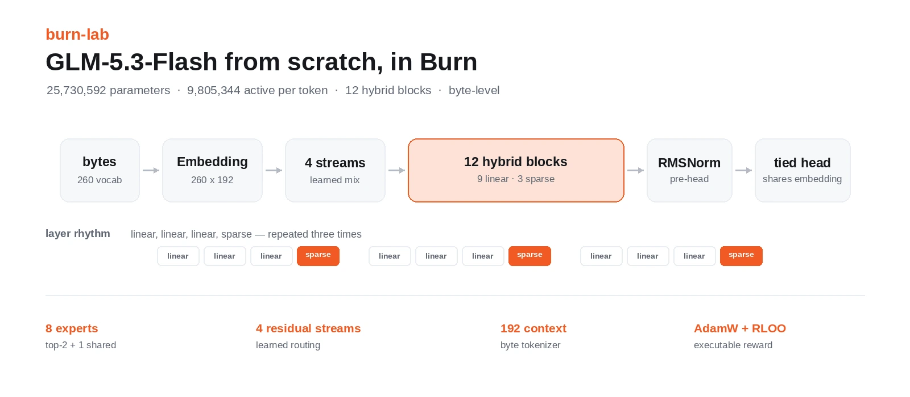
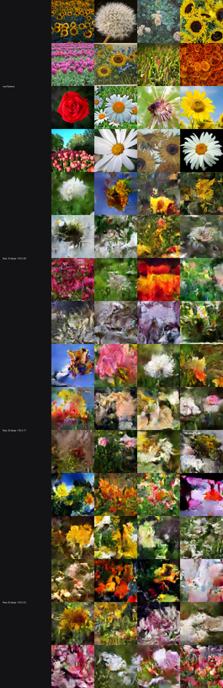
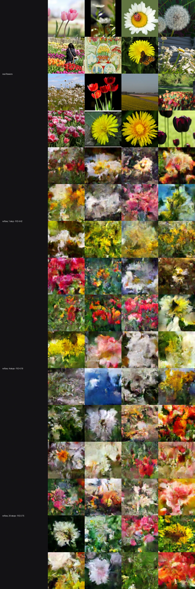
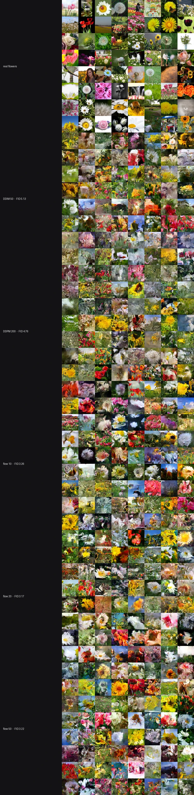

# burn-lab

<div align="center">
  
  <br/><br/>

  
  
  
  
</div>

---

## What this is

Two real workloads ported to [Burn](https://github.com/tracel-ai/burn), plus the MNIST lab it started
from:

- **`diffusion/`** — DDPM, DDIM and rectified flow on the TensorFlow `flower_photos` set, with a
  pixel-space Fréchet metric, a measured real-image floor, and saved checkpoints.
- **`glm53/`** — a 25.7M-parameter GLM-5.3-Flash port trained from scratch and post-trained with
  executable-reward RL.
- **`src/`** — the Burn Book's MNIST workflow, with a live dashboard.

The diffusion work is the most complete: every number below is a held-out measurement, and the
failures are recorded beside the wins.

## Diffusion results

<p align="center"></p>

64×64 flowers, 3,303 training images and 367 held out, 512 samples per draw, EMA weights, pixel-FID
at 8×8×3 pooling. The real-image floor on the same estimator is **2.957 ± 0.234** — a perfect model
cannot score zero, and 4.0 was the target this project set itself.

| Model | Sampler | Steps | pixel-FID | nearest L1 | grad ratio |
| --- | --- | ---: | ---: | ---: | ---: |
| 32×32 `dim 16`, 4k (baseline) | DDIM | 50 | 9.224 | 0.319 | 1.353 |
| 64×64 `dim 16`, 7k | DDIM | 50 | 6.541 | 0.307 | 0.984 |
| 64×64 `dim 16`, 24k | DDIM | 50 | 5.956 | 0.302 | 0.947 |
| 64×64 `dim 16`, 48k | DDIM | 50 | 7.341 | 0.297 | 0.979 |
| 64×64 `dim 24`, 13k | DDIM | 50 | 5.131 | 0.313 | 0.939 |
| 64×64 `dim 24`, 13k | DDPM | 200 | 4.761 | 0.315 | 0.966 |
| 64×64 `dim 24`, 13k | **flow** | **20** | **3.170** | 0.334 | 1.063 |
| 128×128 `dim 16`, 14k | flow | 20 | 6.450 | 0.358 | 1.240 |
| 64×64 `dim 24`, reflow | flow | 1 | **4.079** | 0.331 | 1.056 |
| 64×64 `dim 24`, 34,476 images, 22k | flow | 20 | 5.963 | 0.349 | 0.987 |
| 64×64 ViT `dim 256`, 13k | flow | 20 | 7.666 | 0.345 | 1.479 |
| 128×128 ViT `dim 256`, 13k | flow | 20 | 14.516 | 0.743 | 9.641 |
| 64×64 `dim 24`, consistency | flow | 1 | 26.059 | — | — |
| real images vs held out | — | — | 2.957 ± 0.234 | 0.329 | 1.000 |

Three points carry the study:

- **The objective is the biggest lever.** The same UNet, data, seed and 13,000 steps: DDPM 4.761,
  rectified flow **3.170**. That is a larger effect than any sampler or step-count change.
- **Steps are not monotone.** 7k → 24k improves by 0.59; 24k → 48k *harms* by 1.38 while the training
  loss keeps falling.
- **The data lever works in the metric that sees detail.** Ten times the photographs (TensorFlow flowers + Oxford 102, with random-resized-crop augmentation) took Inception-256 FID from 151.0 to **106.5** against a floor of 17.8, while 8×8 pixel-FID moved the other way, 3.40 to 5.96. The two metrics measure different things; the coarse one cannot see what the extra data bought.
- **The solver matters most before reflow.** At 2 network evaluations midpoint scores 18.99 and Euler 22.93 on the flow model, but Euler scores 4.49 on the reflowed model. Heun, a higher-order method, is worse than Euler: on this velocity field the midpoint's half-step is better damped than a trapezoid.
- **Reflow buys the cheap end.** One Euler step goes from 24.967 to **4.079**, a 6.1× improvement, at
  a cost of 0.7 at twenty steps.
- **Resolution costs compute, and the metric cannot see it.** The same 112k-image budget at 128×128
  scores 6.450, worse than 64×64's 3.170 on the coarse estimator — whose real-image floor is identical
  at both resolutions (2.945 vs 2.957), because 8×8 pooling discards detail.

<p align="center"></p>

### The models

| Checkpoint | What it is | Size |
| --- | --- | --- |
| [`models/flowers-64-dim24-13k`](models/flowers-64-dim24-13k) | the 64×64 DDPM/DDIM model, `dim 24`, 13k steps | 21 MB |
| [`models/flowers-64-flow-dim24-13k`](models/flowers-64-flow-dim24-13k) | same UNet, rectified-flow objective, FID 3.170 | 21 MB |
| [`models/flowers-64-reflow-dim24-6k`](models/flowers-64-reflow-dim24-6k) | reflow pass, one-step sampling | 21 MB |
| [`models/flowers-64-flow-big-dim24-22k`](models/flowers-64-flow-big-dim24-22k) | flow on 10× data (TF + Oxford 102), best Inception score | 21 MB |

Each has a card with its checksum, metrics and a one-line sampling command.

```sh
cargo run -p diffusion --release -- sample --backend wgpu \
  --ckpt models/flowers-64-flow-dim24-13k --samples 16 --sampling-steps 20
```

### What the pictures show

<p align="center"></p>

DDIM is a soft colour mass, DDPM has petal edges, rectified flow holds daisy petals and flower
centres. The gradient-energy ratio tracks it exactly: flow 1.06, DDPM 0.97, DDIM 0.94, photographs
1.00.

### The measurement story

Four things were fixed by measuring rather than guessing, and each is written up in
[`diffusion/README.md`](diffusion/README.md):

- **A loader defect** fed the model a channel permutation while the sample writer undid it on
  display. Loss and distance were self-consistent; only rendering the same tensor two ways exposed
  it. Fixing it moved the same configuration from 10.28 to 6.54.
- **The 128-sample Fréchet estimate was rank-deficient** (192 dimensions, 127 rank). The ±1.5 "noise"
  it produced was the estimator failing, not the model; every number here uses 256 or 512 samples.
- **A real-image floor** was measured before the 4.0 target was accepted (2.957 ± 0.234), so the
  target meant something.
- **The metric is not Inception FID.** In Inception-v3 space with a measured real-image floor (17.79
  at 256 projected dimensions), the flow model scores 151.04 — **8.5× the floor**, where the pixel
  estimator says 1.07×. The 8×8 metric measures coarse colour and layout; nothing here is comparable
  with a paper's FID.
- **Consistency flow matching did not work here.** Trained at the same budget it scores 26.06 at one
  step and 3.71 at twenty: no few-step gain. The likely causes — a shared 0.999 EMA instead of a
  dedicated 0.9999 shadow, and a constant delta instead of a schedule — are recorded in the diffusion
  README as an untested hypothesis, not an excuse.
- **A ViT backbone** (20.3M parameters, `vit-pytorch`) trained under the same flow objective reached
  7.666 at 64×64 and 14.516 at 128×128, against the UNet's 3.170; at 128 the samples are 16×16
  blocky noise. The JetViT post-training attention swap found nothing it could replace without
  distillation (+92% to +734% loss). All three are recorded as negative results.
- **128×128 costs more than it gives at fixed compute.** Same 112k-image budget: 6.450 against
  64×64's 3.170 on the coarse estimator, whose floor is identical at both resolutions (2.945 vs
  2.957) because 8×8 pooling discards detail.
- **The metric is not Inception FID.** In Inception-v3 space with a measured real-image floor (17.79
  at 256 projected dimensions), the flow model scores 151.04 — **8.5× the floor**, where the pixel
  estimator says 1.07×. The 8×8 metric measures coarse colour and layout; nothing here is comparable
  with a paper's FID.

### Flower classification, briefly

The ViT was also tried on five-class flower classification with a streaming
64×64 u8 loader: peak RSS **439 MB**, 16 s for 1,000 steps, and **32.9% +- 2.7%** exact held-out
accuracy over three runs at 1,500 steps against 20% chance. A CLS token and a larger model
were both worse and used 4x the memory; mean pooling and a small model won.
See [`diffusion/README.md`](diffusion/README.md) for the review trail.

## Quick start

```sh
git clone https://github.com/adeerkhan/burn-lab
cd burn-lab
cargo test --workspace --release          # 122 tests

# Diffusion: train, sample, evaluate
python3 scripts/prepare_flowers.py --size 64 --holdout 0.1 \
  --out /tmp/flowers/train64.bin --holdout-out /tmp/flowers/held64.bin
cargo run -p diffusion --release -- train --flow --backend wgpu \
  --data /tmp/flowers/train64.bin --image-size 64 --dim 24 --steps 13000 \
  --batch 16 --ema-decay 0.999 --checkpoint-every 1000 --out /tmp/flow
cargo run -p diffusion --release -- sample --backend wgpu \
  --ckpt /tmp/flow --samples 16 --sampling-steps 20
python3 scripts/ddpm_fidelity.py --samples /tmp/flow/ddim50.raw \
  --held /tmp/flowers/held64.bin --train /tmp/flowers/train64.bin --size 64
```

The language model, vision path and RL studies are documented in [`glm53/README.md`](glm53/README.md).

## A second workload: language modelling

`glm53/` ports a 25.7M-parameter GLM-5.3-Flash: hybrid attention, sparse mixture of experts, four
residual streams, pretrained on a synthetic Python corpus and post-trained with RLOO against
executable unit-test rewards. Pretraining takes 155 s on the same RTX 5060; dev pass@1 saturates at
32/32 by step 400.

The transferable result is the **RL band**: executable-reward RL has a capability floor (every
rollout invalid, every advantage zero) and a capability ceiling (nothing left to correct), and only a
narrow band between them responds. The reference's checkpoint landed inside it; ours did not, and the
write-up shows why. Full tables and the negative replication are in [`glm53/README.md`](glm53/README.md).

### A miniature world model

A second new workload in `diffusion/`: record a FireflyRoom (flashlight, boxes,
wandering fireflies), tokenize frames to 16x16 integer codes with a VQ-VAE,
predict the next frame's codes with an action-conditioned spatio-temporal
transformer, and roll out a dream. All stages train in minutes here; the dream
moves the objects correctly but is limited by tokenizer blur — see the
[10-second clip](docs/world-dream.mp4). Training on the model's own mistakes cut
the first-10-step error from 36.7 to 25.1, and a pixel-anchored residual head
that predicts only the *change* brought the 120-step rollout to 21.6 / 36.4 /
42.6, beating the copy-last-frame baseline. The
[three-way comparison clip](docs/world-compare.mp4) shows real, dream and the
trivial baseline side by side; an ablation sweep found that better tokenizer
reconstruction alone does not improve a long dream. There is also a
[playable demo](diffusion/README.md#playable-demo) — arrow keys drive both the
real room and the dream, with space to re-sync — and a
[10-second playthrough](docs/world-play.mp4).

## Repository layout

```
burn-lab/
├── src/                  # the MNIST lab (Burn Book basic workflow)
├── diffusion/            # DDPM / DDIM / rectified flow / reflow / ViT
│   ├── src/
│   │   ├── unet.rs          the reference UNet, and the backbone enum
│   │   ├── vit.rs           viT backbone and JetViT attention search
│   │   ├── diffusion.rs     schedules, q_sample, DDPM, DDIM
│   │   ├── flow.rs          rectified flow, consistency, reflow pair loss
│   │   ├── ema.rs           shadow weights
│   │   └── inspect.rs       weight and gradient dumps
│   └── tests/            # parity against the reference, flow, ViT, loader
├── models/               # saved checkpoints with their metrics
├── scripts/              # data packing, fidelity, floor, curves, heatmaps
├── docs/                 # figures
└── glm53/                # the language-model port
```

## Tests

```sh
cargo test --workspace --release          # 122 passing, 1 ignored
cargo clippy --workspace --release --all-targets
```

The diffusion suite includes five numerical parity tests against values extracted from the reference
source, the flow interpolation and objective tests, the ViT shape and attention-swap tests, and the
loader layout test that pins channel order.

## Credits and license

- [`lucidrains/denoising-diffusion-pytorch`](https://github.com/lucidrains/denoising-diffusion-pytorch)
  and [`lucidrains/rectified-flow-pytorch`](https://github.com/lucidrains/rectified-flow-pytorch) —
  the diffusion references, MIT.
- [`lucidrains/vit-pytorch`](https://github.com/lucidrains/vit-pytorch) and *JetViT* (CVPR 2026
  Findings) — the ViT backbone and attention-search idea.
- [`vukrosic/glm-5.3-flash-from-scratch`](https://github.com/vukrosic/glm-5.3-flash-from-scratch) — the
  language model and RL method, MIT.
- [Burn](https://github.com/tracel-ai/burn) by Tracel AI, MIT/Apache-2.0.

This port is MIT.
