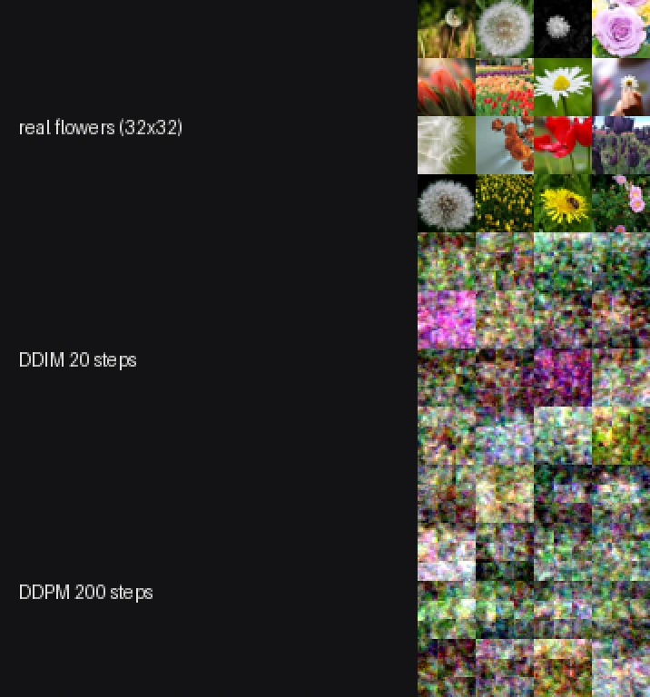
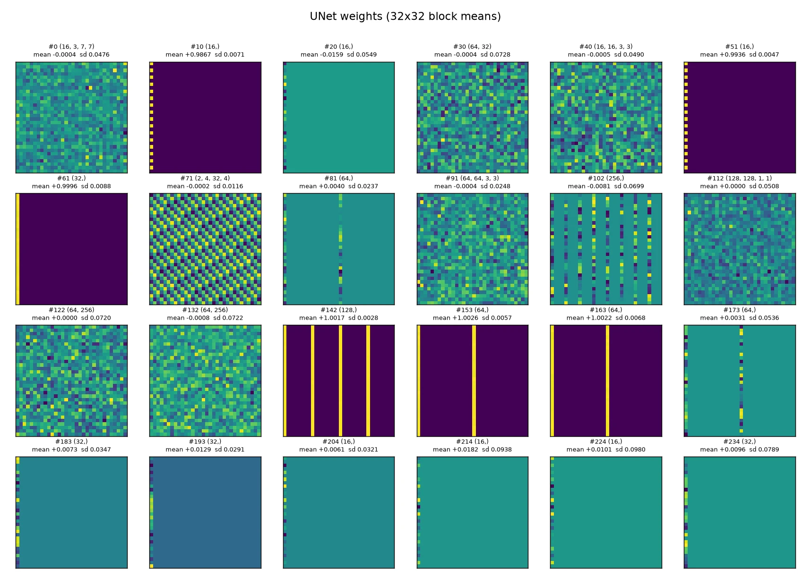
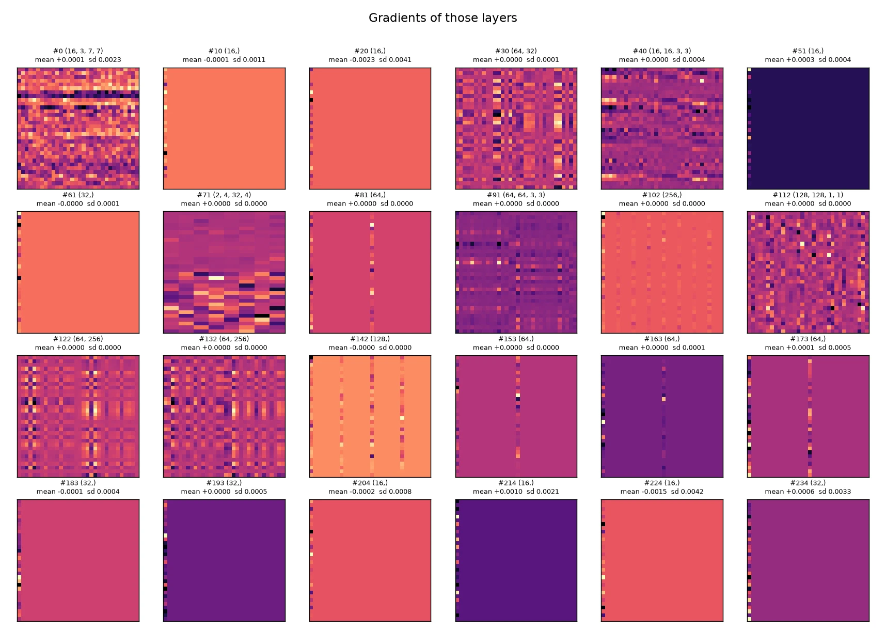
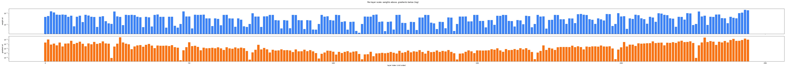

# diffusion

A port of [`lucidrains/denoising-diffusion-pytorch`](https://github.com/lucidrains/denoising-diffusion-pytorch)
(v2.3.4) to Burn: the reference's `Unet` and `GaussianDiffusion`, training loop,
EMA and DDIM sampler.

It exists as a second, independent Burn workload next to `glm53`. Where that port
is a language model, this one exercises convolution, residual blocks, attention
over a spatial grid, and the diffusion maths that FLUX-style models share.

## What is ported

| Reference | Here |
| --- | --- |
| `Unet` with `dim_mults`, RMSNorm, sinusoidal position embedding, `ResnetBlock` with time-conditioned scale/shift, linear and full attention with memory keys/values, pixel-unshuffle downsample, nearest upsample | `src/unet.rs` |
| `GaussianDiffusion`: linear, cosine and sigmoid beta schedules, `pred_noise` / `pred_x0` / `pred_v`, `q_sample`, `p_losses`, min-SNR loss weighting, DDPM `p_sample`, DDIM sampling | `src/diffusion.rs` |
| `ema_pytorch` in the trainer | `src/ema.rs` |
| `Dataset` over a folder of images | `src/data.rs`, synthetic shapes instead of CIFAR-10 |

## Verification

`tests/parity.rs` compares against numbers extracted from the reference source
itself (`tests/data/schedules.json`), not against a retyped formula:

- all three beta schedules and their `alphas_cumprod`, to 1e-6;
- `q_sample` at t = 0, 7, 199, to 1e-6;
- the UNet preserves the image shape at a downsample factor of 4;
- DDIM sampling is deterministic when the device is seeded;
- one EMA blend step lands halfway between the shadow and the live weights.

One reference quirk is reproduced deliberately: it builds `v_start`/`v_end` with
`torch.tensor(...)`, which is f32, and then divides an f64 tensor by them. Doing
the same keeps the schedule buffers equal to the reference's.

## Results: ours against the reference, same data and budget

The reference has **no test suite** — no `tests/`, no `test_*` functions, no CI
workflow — so what can be run is its training and inference paths. Both were run
on the same eight shapes, the same architecture and the same budget.


| Run | Params | Train | DDIM 20 | DDPM 200 |
| --- | ---: | ---: | ---: | ---: |
| Untrained | — | — | 0.861 | — |
| Reference, 900 steps | 2,439,043 | 83 s | 0.136 (0.6 s) | **0.133** (5.2 s) |
| Ours, 900 steps | 2,439,043 | 193 s | 0.245 (1.1 s) | **0.188** (11.2 s) |
| Reference, 3000 steps | 2,439,043 | 407 s | 0.052 (0.7 s) | **0.0397** (9.2 s) |
| Ours, 3000 steps | 2,439,043 | 664 s | 0.076 (1.1 s) | **0.047** (11.7 s) |

Metric: mean L1 distance from a sample to the closest of the eight templates
(zero would be a perfect reproduction).

What this shows:

- **The architecture is right**: the parameter count matches the reference
  exactly, 2,439,043.
- **Both samplers work, in both implementations.** DDPM at 200 steps beats DDIM
  at 20 in every case (0.133 vs 0.136, 0.188 vs 0.245, 0.047 vs 0.076), which is
  the expected trade.
- **At equal steps the reference is still ahead, but by less over time.** At 900
  steps it is 0.133 against 0.188; at 3000 it is 0.0397 against 0.047, and the
  reference trains in 407 s against 664 s. The gap narrows rather than closing,
  which points at training dynamics — Burn's default initialisers differ from
  PyTorch's — rather than at a structural difference. The parameter count is
  identical, so the architecture is not the explanation.
- **Both reach recognisable shapes**: at 3000 steps a sample is within 0.047 mean
  absolute difference of a template, against 0.861 for an untrained model.

Reproduce with:

```sh
/tmp/glm-venv/bin/python scripts/ddpm_reference_run.py --steps 900
cargo run -p diffusion --release -- train --steps 900 --batch 16 \
    --image-size 16 --dim 16 --timesteps 200 --sampling-steps 20 --out artifacts/ddpm
cargo run -p diffusion --release -- sample --ckpt artifacts/ddpm --sampling-steps 200
```

## Flowers, and what the weights and gradients look like

The synthetic shapes are a sanity check. For a real distribution, the TensorFlow
`flower_photos` set (3,670 images, five classes) was centre-cropped and resized to
32×32, then trained for 4,000 steps at `dim` 16 on `wgpu`.



| Sampler | Steps | Time (16 images) | Mean L1 to the nearest training image |
| --- | ---: | ---: | ---: |
| DDIM | 20 | 1.35 s | 0.340 |
| DDPM | 200 | 4.76 s | 0.340 |

**DDIM and DDPM share one set of weights.** They are two ways to run the same
model, so there is no "DDIM model" and "DDPM model" to compare; the difference is
the sampling trajectory. At 32×32 and 4,000 steps the samples are colour and
shape blobs rather than recognisable flowers — that is the honest state of this
run, not a rendering artefact.

### Weight and gradient heatmaps

`--dump` writes a per-tensor summary — shape, mean, sd, min, max, zero fraction,
and a 32×32 block-mean grid — for the weights and for the gradients of the last
training step. `scripts/plot_ddpm_inspection.py` renders them.







What the dump says about this model:

- **245 parameter tensors, and every one receives a non-zero gradient** on a
  random batch. Nothing is disconnected.
- Weight sd ranges from `1.9e-3` to `2.0e-1` (median `3.6e-2`); gradient sd from
  `2.7e-7` to `3.2e-2` (median `1.3e-4`), about five orders of magnitude between
  the quietest and loudest tensor.
- Grouped by shape, the picture is not "deep layers are quiet":

  | Group | Tensors | Weight sd | Gradient sd |
  | --- | ---: | ---: | ---: |
  | 1×1 convolutions | 31 | `7.8e-2` | `1.1e-3` |
  | 3×3 convolutions | 43 | `3.3e-2` | `8.1e-4` |
  | 7×7 stem | 1 | `4.8e-2` | `2.3e-3` |
  | linear (time MLP) | 21 | `7.7e-2` | `2.0e-4` |
  | norms and biases | 140 | `3.6e-2` | `1.5e-3` |
  | memory keys/values | 9 | `1.2e-2` | **`5.4e-7`** |

- The 1×1 and linear layers carry the largest weights, but the linear layers get
  roughly ten times smaller gradients than the 1×1 convolutions. The memory
  keys/values are the quietest by far: real gradients, three orders of magnitude
  below everything else.
- Weight magnitude and gradient magnitude are only weakly related: `r = +0.33`
  between their logs. A large weight does not predict a large update.

## Usage

```sh
cargo run -p diffusion --release -- smoke                 # 120 steps, samples
cargo run -p diffusion --release -- train --steps 900 --image-size 16 --dim 16 \
    --timesteps 200 --sampling-steps 20 --out artifacts/ddpm
cargo run -p diffusion --release -- sample --ckpt artifacts/ddpm --samples 16
```

`--sampling-steps` below `--timesteps` switches `sample()` to DDIM; equal values
run the full DDPM chain.

## Deviations from the reference

- **Synthetic shapes, not CIFAR-10.** The reference trains on a folder of images
  through `torchvision`. That download is not part of this example; eight
  templates keep it self-contained and make the metric meaningful.
- **No self-conditioning.** The reference has an optional second pass that feeds
  back the predicted `x0`; it is left out rather than half-implemented.
- **Memory keys and values are deterministic.** The reference draws them with
  `randn`; here they are a small fixed ramp. They are learnable either way.
- **No flash attention, no FID, no `accelerate`.** Full attention is a plain
  `softmax(q k^T / sqrt(d)) v`; quality is measured with a distance to the
  closest template instead of FID.
- **The EMA is a plain blend.** `ema_pytorch` supports warmup and per-parameter
  decay; the port keeps the part the training loop uses.
