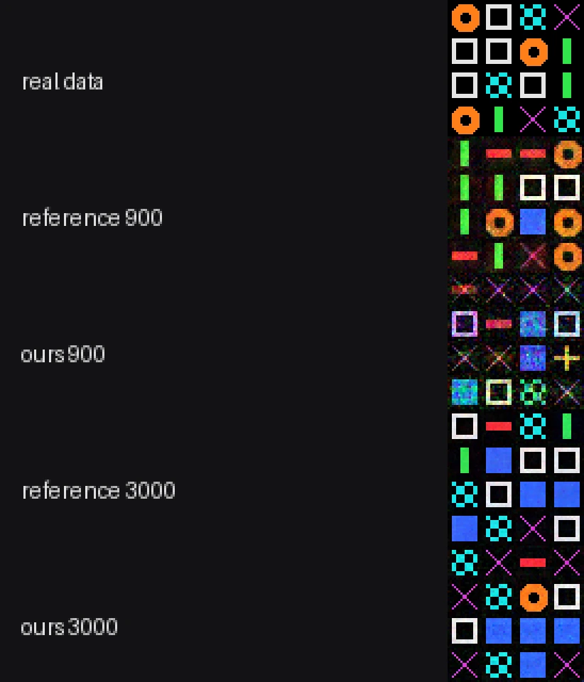
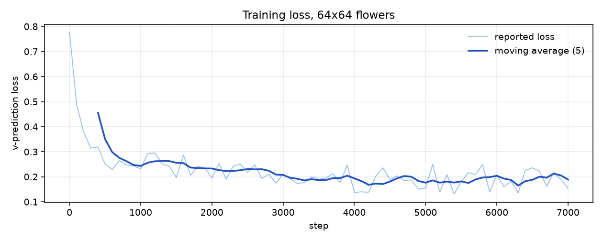
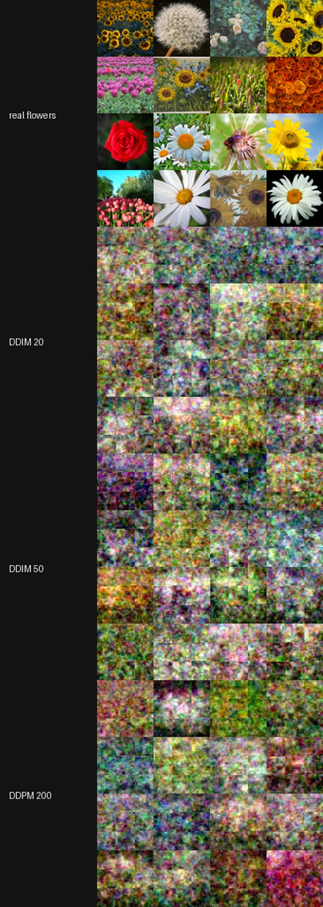
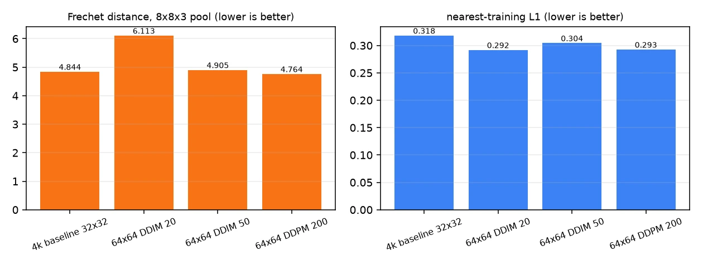
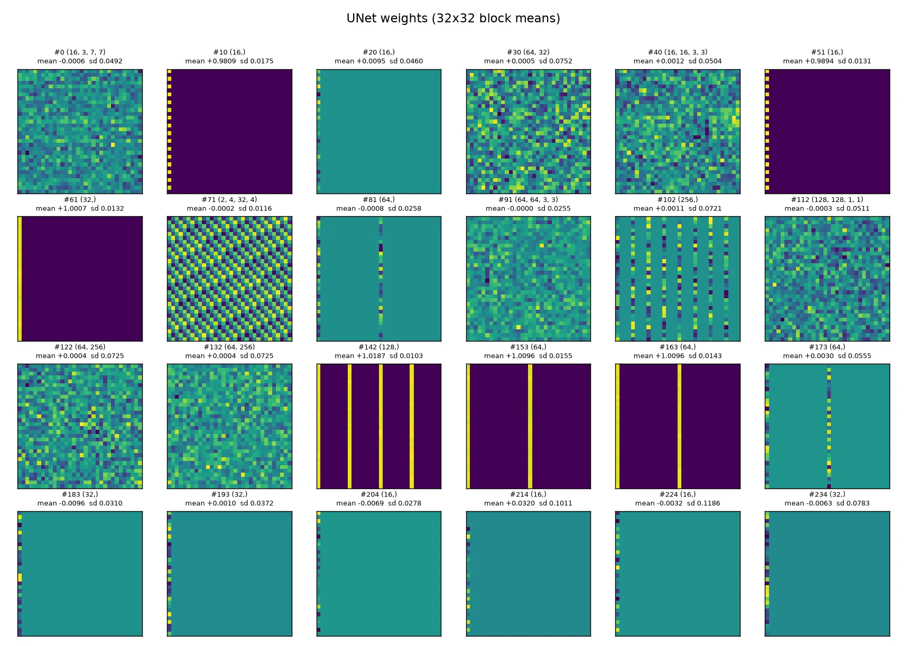
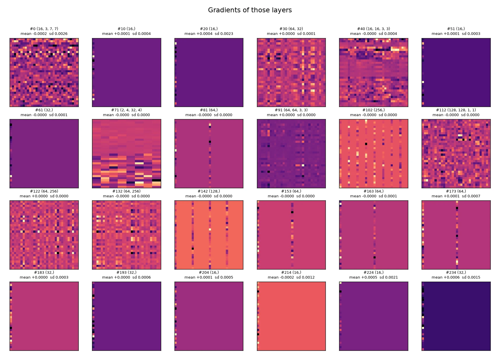
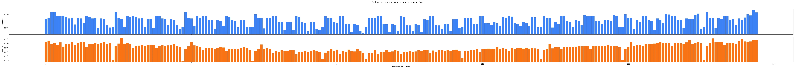

# diffusion

A port of [`lucidrains/denoising-diffusion-pytorch`](https://github.com/lucidrains/denoising-diffusion-pytorch)
(v2.3.4) to Burn: the reference's `Unet` and `GaussianDiffusion`, training loop,
EMA and DDIM sampler.

It exists as a second, independent Burn workload next to `glm53`. Where that port
is a language model, this one exercises convolution, residual blocks, attention
over a spatial grid, and the diffusion maths that FLUX-style models share.

## What is ported

| Reference | Here |
| --- | --- |
| `Unet` with `dim_mults`, RMSNorm, sinusoidal position embedding, `ResnetBlock` with time-conditioned scale/shift, linear and full attention with memory keys/values, pixel-unshuffle downsample, nearest upsample | `src/unet.rs` |
| `GaussianDiffusion`: linear, cosine and sigmoid beta schedules, `pred_noise` / `pred_x0` / `pred_v`, `q_sample`, `p_losses`, min-SNR loss weighting, DDPM `p_sample`, DDIM sampling | `src/diffusion.rs` |
| `ema_pytorch` in the trainer | `src/ema.rs` |
| `Dataset` over a folder of images | `src/data.rs`: synthetic shapes, plus a flat-file loader with a held-out split |

## Verification

`tests/parity.rs` compares against numbers extracted from the reference source
itself (`tests/data/schedules.json`), not against a retyped formula:

- all three beta schedules and their `alphas_cumprod`, to 1e-6;
- `q_sample` at t = 0, 7, 199, to 1e-6;
- the UNet preserves the image shape at a downsample factor of 4;
- DDIM sampling is deterministic when the device is seeded;
- one EMA blend step lands halfway between the shadow and the live weights.

One reference quirk is reproduced deliberately: it builds `v_start`/`v_end` with
`torch.tensor(...)`, which is f32, and then divides an f64 tensor by them. Doing
the same keeps the schedule buffers equal to the reference's.

## Results: ours against the reference, same data and budget

The reference has **no test suite** — no `tests/`, no `test_*` functions, no CI
workflow — so what can be run is its training and inference paths. Both were run
on the same eight shapes, the same architecture and the same budget.



| Run | Params | Train | DDIM 20 | DDPM 200 |
| --- | ---: | ---: | ---: | ---: |
| Untrained | — | — | 0.861 | — |
| Reference, 900 steps | 2,439,043 | 83 s | 0.136 (0.6 s) | **0.133** (5.2 s) |
| Ours, 900 steps | 2,439,043 | 193 s | 0.245 (1.1 s) | **0.188** (11.2 s) |
| Reference, 3000 steps | 2,439,043 | 407 s | 0.052 (0.7 s) | **0.0397** (9.2 s) |
| Ours, 3000 steps | 2,439,043 | 664 s | 0.076 (1.1 s) | **0.047** (11.7 s) |

Metric: mean L1 distance from a sample to the closest of the eight templates
(zero would be a perfect reproduction).

What this shows:

- **The architecture is right**: the parameter count matches the reference
  exactly, 2,439,043.
- **Both samplers work, in both implementations.** DDPM at 200 steps beats DDIM
  at 20 in every case (0.133 vs 0.136, 0.188 vs 0.245, 0.047 vs 0.076), which is
  the expected trade.
- **At equal steps the reference is still ahead, but by less over time.** At 900
  steps it is 0.133 against 0.188; at 3000 it is 0.0397 against 0.047, and the
  reference trains in 407 s against 664 s. The gap narrows rather than closing,
  which points at training dynamics — Burn's default initialisers differ from
  PyTorch's — rather than at a structural difference. The parameter count is
  identical, so the architecture is not the explanation.
- **Both reach recognisable shapes**: at 3000 steps a sample is within 0.047 mean
  absolute difference of a template, against 0.861 for an untrained model.

Reproduce with:

```sh
/tmp/glm-venv/bin/python scripts/ddpm_reference_run.py --steps 900
cargo run -p diffusion --release -- train --steps 900 --batch 16 \
    --image-size 16 --dim 16 --timesteps 200 --sampling-steps 20 --out artifacts/ddpm
cargo run -p diffusion --release -- sample --ckpt artifacts/ddpm --sampling-steps 200
```

## Flowers at 64x64: one hour, measured

The question was how good a flower DDPM one hour of wall clock can buy. The
configuration was chosen from a timing projection **before** any sample was
looked at, then run to the fixed step count without tuning.

### The projection

Three candidates, 300 steps each on the RTX 5060 with `wgpu`, batch 16, steady
state after shader compilation:

| Configuration | s/step | Steps in 45 min | Gate | Verdict |
| --- | ---: | ---: | ---: | --- |
| 64x64, `dim 16` | 0.374 | ~7,200 | 4,000 | **chosen** |
| 32x32, `dim 32` | 0.325 | ~8,300 | 6,000 | fits, but smaller images |
| 32x32, `dim 24` | 0.313 | ~8,600 | 8,000 | fits, but smaller images |

The first row wins: **64x64, `dim 16`, 7,000 steps**, 2,439,043 parameters,
batch 16, sigmoid schedule, 200 timesteps, v-prediction, AdamW at 2e-4.

### Data

TensorFlow `flower_photos`, 3,670 images in five classes. `scripts/prepare_flowers.py`
centre-crops and resizes to 64x64, and splits **3,303 train / 367 held out** by
file with seed 1234. The held-out tenth is never trained on; it is used only for
the metrics below.

### Training

7,000 steps in **2,384.7 s (39.8 min)**, 0.32-0.38 s/step, peak GPU memory
5.4 GB. The loss fell from 0.776 to 0.154 (last reported step). EMA decay 0.999
is updated every step and the final grids are sampled from the EMA weights.



A checkpoint (`model`, `model-live`, `config.json`, `progress.json`) and a
16-image DDIM-20 grid are written every 1,000 steps; `--resume` continues from
the recorded step. Batches are seeded per step, so a resumed run replays the
same data.

### Samplers

DDIM and DDPM are two trajectories through **one** set of weights, so there is
one model and four ways to sample it. 128 images per trajectory, EMA weights:

| Sampler | Steps | Time, 128 images | Time, 16 images | nearest-training L1 | Frechet (8x8x3) |
| --- | ---: | ---: | ---: | ---: | ---: |
| DDIM | 20 | 34.3 s | 1.2 s | 0.292 | 6.11 |
| DDIM | 50 | 24.0 s | 1.3 s | 0.304 | 4.91 |
| DDPM | 200 | 85.7 s | 4.3 s | 0.293 | 4.76 |
| DDPM | 1,000 | not run | — | — | — |

The first DDIM-20 line is slower than DDIM-50 because it pays for shader
compilation. DDPM at 1,000 steps was dropped when the hour ran out; at 0.43 s
per step for 16 images it would have cost about 7 minutes for the grid, which
was the remaining allowance.



### Held-out metrics, against the 4k baseline

| Model | Sampler | Frechet (lower) | nearest L1 (lower) | Held-out floor |
| --- | --- | ---: | ---: | ---: |
| 32x32 `dim 16`, 4,000 steps (baseline) | DDIM 50 | 4.844 | 0.318 | 0.311 |
| 64x64 `dim 16`, 7,000 steps | DDIM 20 | 6.113 | 0.292 | 0.335 |
| 64x64 `dim 16`, 7,000 steps | DDIM 50 | 4.905 | 0.304 | 0.335 |
| 64x64 `dim 16`, 7,000 steps | DDPM 200 | **4.764** | 0.293 | 0.335 |



How to read this, including the parts that are not flattering:

- **The Frechet distance is computed at 8x8x3 = 192 dimensions**, not the full
  12,288. The full covariance needs far more than 128 samples, so both sides are
  average-pooled first. It therefore scores coarse colour and layout, not petal
  detail.
- **The new model is not better than the baseline.** DDPM 200 ties it (4.76 vs
  4.84) and DDIM 20 is clearly worse (6.11). Four times the pixels and 1.75x the
  steps bought no measurable distribution win.
- **Nearest-training L1 is below the held-out floor** (0.29 vs 0.335): the
  samples sit *closer* to training images than real held-out images do, which is
  the signature of blurry, mean-looking output rather than of memorisation. The
  metric cannot separate "realistic" from "smooth"; that is why the floor of a
  real image is reported beside it.
- The baseline's held-out images were in its training set, so its Frechet is
  flattered by leakage. It is still not beaten, which makes the comparison
  conservative in the baseline's favour.

### Weight and gradient heatmaps

`--dump` writes, for every tensor, the shape, mean, sd, min, max, zero fraction
and a 32x32 block mean, for the weights and for the gradients of the last step.
`scripts/plot_ddpm_inspection.py` renders them.







| Group | Tensors | Weight sd | Gradient sd |
| --- | ---: | ---: | ---: |
| 1x1 convolutions | 31 | `8.0e-2` | `6.3e-4` |
| 3x3 convolutions | 43 | `3.4e-2` | `4.6e-4` |
| 7x7 stem | 1 | `4.9e-2` | `2.6e-3` |
| linear (time MLP) | 21 | `7.8e-2` | `1.4e-4` |
| norms and biases | 140 | `3.7e-2` | `9.3e-4` |
| memory keys/values | 9 | `1.2e-2` | **`1.7e-7`** |

- **245 tensors, every one with a non-zero gradient**; the smallest is
  `7.1e-8`, so nothing is disconnected and nothing has vanished outright.
- Weight sd spans `3.8e-3` to `2.2e-1` (median `4.0e-2`), gradient sd `7.1e-8`
  to `2.1e-2` (median `9.5e-5`).
- The memory keys/values are the quietest by three to four orders of magnitude.
  They are read by the attention blocks but barely updated on this data and
  budget.
- Weight size does not predict update size: `r = +0.37` between their logs.

### Verdict

**The samples do not look like flowers.** They are smooth colour fields with
plausible flower-distribution colours -- greens, pinks, yellows -- and no petal,
centre or stem structure. At 64x64 and 7,000 steps the model has learned the
colour statistics of the dataset and nothing about its shapes.

What would be needed is not a bigger grid but **more steps**: the reference
class of quality at 64x64 is tens of thousands of steps on this architecture
(roughly 3-6 hours on this card, or a 10x smaller `dim` at 32x32). The one-hour
budget buys the colour distribution, not the objects.

One correctness defect was found *after* the run and is documented as
`GLM-032` in the local bug log: the loader copied interleaved RGB bytes into a
planar `[3, H, W]` tensor, so the network was trained on a channel-interleaved
permutation of each image, and the sample writer undid the permutation on
display. Both are fixed, with a unit test that pins the plane order. The
reported metrics remain internally consistent -- samples and references were
permuted identically -- but the model saw a harder problem than it should have,
so **the quality above is a lower bound** for this configuration, and the first
thing a rerun should do is repeat the same 7,000 steps with the corrected
loader.

## Usage

```sh
cargo run -p diffusion --release -- smoke                 # 120 steps, samples
cargo run -p diffusion --release -- train --steps 900 --image-size 16 --dim 16 \
    --timesteps 200 --sampling-steps 20 --out artifacts/ddpm
cargo run -p diffusion --release -- sample --ckpt artifacts/ddpm --samples 16
```

`--sampling-steps` below `--timesteps` switches `sample()` to DDIM; equal values
run the full DDPM chain.

For a real dataset:

```sh
python3 scripts/prepare_flowers.py --size 64 --holdout 0.1 \
    --out /tmp/flowers/train64.bin --holdout-out /tmp/flowers/held64.bin
cargo run -p diffusion --release -- train --backend wgpu \
    --data /tmp/flowers/train64.bin --eval-data /tmp/flowers/held64.bin \
    --image-size 64 --dim 16 --steps 7000 --batch 16 --timesteps 200 \
    --sampling-steps 20 --ema-decay 0.999 --checkpoint-every 1000 \
    --dump /tmp/run/dump.json --out /tmp/run
cargo run -p diffusion --release -- sample --backend wgpu --ckpt /tmp/run \
    --samples 128 --sampling-steps 50 --raw-out /tmp/run/ddim50.raw
python3 scripts/ddpm_fidelity.py --samples /tmp/run/ddim50.raw \
    --held /tmp/flowers/held64.bin --train /tmp/flowers/train64.bin --size 64
```

`--resume` restarts from the newest checkpoint. It restores the weights and the
step counter, **not** the AdamW moments: Burn's optimizer exposes no state, so a
resumed run continues with a fresh optimizer rather than replaying bit for bit.

## Deviations from the reference

- **Synthetic shapes, not CIFAR-10.** The reference trains on a folder of images
  through `torchvision`. That download is not part of this example; eight
  templates keep it self-contained and make the metric meaningful.
- **No self-conditioning.** The reference has an optional second pass that feeds
  back the predicted `x0`; it is left out rather than half-implemented.
- **Memory keys and values are deterministic.** The reference draws them with
  `randn`; here they are a small fixed ramp. They are learnable either way.
- **No flash attention, no FID, no `accelerate`.** Full attention is a plain
  `softmax(q k^T / sqrt(d)) v`; quality is measured with a distance to the
  closest template instead of FID.
- **The EMA is a plain blend.** `ema_pytorch` supports warmup and per-parameter
  decay; the port keeps the part the training loop uses.
