# diffusion

A port of [`lucidrains/denoising-diffusion-pytorch`](https://github.com/lucidrains/denoising-diffusion-pytorch)
(v2.3.4) to Burn: the reference's `Unet` and `GaussianDiffusion`, training loop,
EMA and DDIM sampler.

It exists as a second, independent Burn workload next to `glm53`. Where that port
is a language model, this one exercises convolution, residual blocks, attention
over a spatial grid, and the diffusion maths that FLUX-style models share.

## Examples: the saved flower model

One checkpoint, two samplers. DDIM and DDPM are two trajectories through the
same weights, so `models/flowers-64-dim24-13k` is the whole model — there is no
"DDIM model" and "DDPM model".

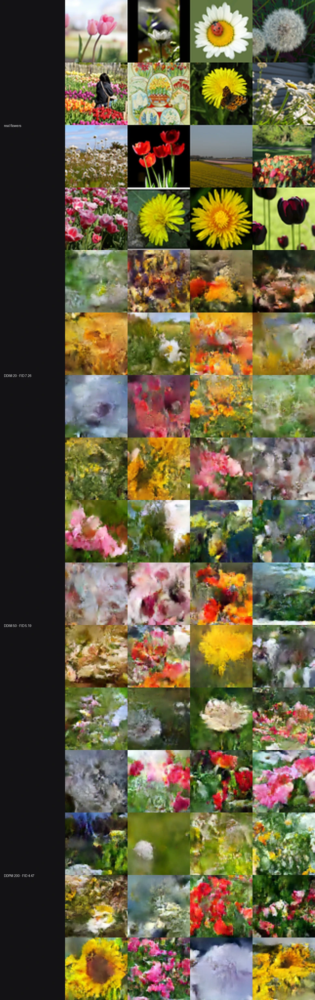

| Sampler | Steps | pixel-FID | nearest L1 | gradient ratio | colour distance |
| --- | ---: | ---: | ---: | ---: | ---: |
| DDIM | 20 | 7.262 | 0.286 | 0.818 | 0.263 |
| DDIM | 50 | 5.131 +- 0.233 | 0.313 | 0.939 | 0.175 |
| **DDPM** | **200** | **4.761 +- 0.346** | 0.315 | 0.966 | 0.145 |
| real images vs held out (floor) | — | 2.957 +- 0.234 | 0.329 | 1.000 | 0.117 |

512 samples per row, EMA weights, 8x8x3 pooled pixels, three draws per sampler
where a spread is shown, the same 367 held-out images. The best single DDPM draw scored 4.474; the three
draws were 4.474, 5.147 and 4.661, which is why the mean is reported.

```sh
cargo run -p diffusion --release -- sample --backend wgpu \
  --ckpt models/flowers-64-dim24-13k --samples 16 --sampling-steps 200
```

The samples are painterly flower masses — sunflower heads, poppies, roses,
foliage, skies — not photographs. At 64x64 individual petals are not resolved.
The weights, their checksum and the full metric table are in
[`models/flowers-64-dim24-13k`](../models/flowers-64-dim24-13k).

### Against the PyTorch reference

The port exists to be compared with the implementation it came from, not to
replace it in a vacuum.

| | This port | Reference (`lucidrains/denoising-diffusion-pytorch`) |
| --- | --- | --- |
| Parameters, `dim 16` | 2,439,043 | 2,439,043 |
| Test suite | 112 workspace tests, five of them numerical parity against extracted reference values | **none** (no `tests/`, no CI) |
| Synthetic shapes, 900 steps, L1 | 0.188 | 0.133 |
| Synthetic shapes, 3,000 steps, L1 | 0.047 | 0.0397 |
| Training, 3,000 steps | 664 s on wgpu | 407 s on CPU |
| Flowers, 64x64 | pixel-FID 4.761 (saved checkpoint) | not run — the available reference environment is CPU-only, and 13,000 steps at 64x64 would take hours |

The reference is faster on the synthetic study and slightly better on the
distance metric; the port matches it to the digit on parameters and is the only
one of the two that can be tested against the other. Its flower run is the part
the reference has not been asked to do.

## Rectified flow

A second objective on the same UNet, ported from
[`lucidrains/rectified-flow-pytorch`](https://github.com/lucidrains/rectified-flow-pytorch).
Instead of learning to denoise a discrete schedule, the network learns a velocity
field that transports Gaussian noise to data along straight paths:

```text
x_t = (1 - t) * noise + t * data      t in [0, 1]
v   = data - noise                    the target
```

Sampling integrates `dx/dt = v(x, t)` from `t = 0` to `t = 1`. The reference uses
`torchdiffeq.odeint` with the midpoint method; this port implements the same
fixed-step midpoint rule, two network evaluations per step.

**It is the best result in this repository.** The same `dim 24`, 64x64 UNet and
the same 13,000 training steps:

| Model | Sampler | Steps | pixel-FID | nearest L1 | gradient ratio | colour distance |
| --- | --- | ---: | ---: | ---: | ---: | ---: |
| DDPM, `dim 24` | DDPM | 200 | 4.761 +- 0.346 | 0.315 | 0.966 | 0.145 |
| DDPM, `dim 24` | DDIM | 50 | 5.131 +- 0.233 | 0.313 | 0.939 | 0.175 |
| **rectified flow** | midpoint | **20** | **3.170 +- 0.074** | 0.334 | 1.063 | 0.101 |
| rectified flow | midpoint | 10 | 3.264 | 0.333 | 1.043 | 0.109 |
| rectified flow | midpoint | 50 | 3.224 | 0.335 | 1.073 | 0.094 |
| real images vs held out (floor) | — | — | 2.957 +- 0.234 | 0.329 | 1.000 | 0.117 |

512 samples per draw, three draws where a spread is shown, EMA weights. **This is
the first model here to beat the 4.0 target**, 1.80 below DDPM's mean and 0.21
above the real-image floor. Ten steps are enough to reach 3.26; twenty are the
best point; fifty buy nothing.

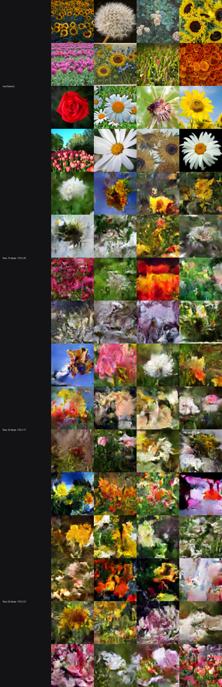

```sh
cargo run -p diffusion --release -- train --flow --backend wgpu \
    --data /tmp/flowers/train64.bin --image-size 64 --dim 24 --steps 13000 \
    --batch 16 --ema-decay 0.999 --out /tmp/flow
cargo run -p diffusion --release -- sample --backend wgpu \
    --ckpt /tmp/flow --samples 16 --sampling-steps 20
```

The weights are in
[`models/flowers-64-flow-dim24-13k`](../models/flowers-64-flow-dim24-13k).

### Visual comparison

Sixty-four samples per method, same 64x64 grid, same held-out reference row:

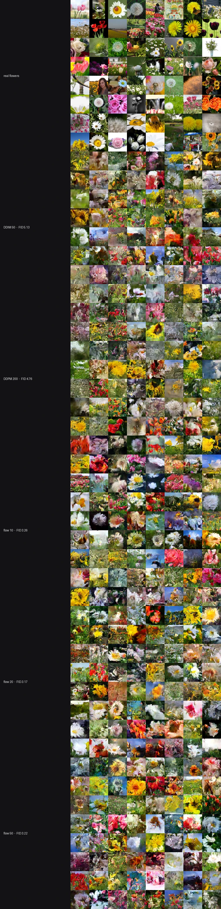

Four samples per method at 3x zoom, where the difference is easiest to see:

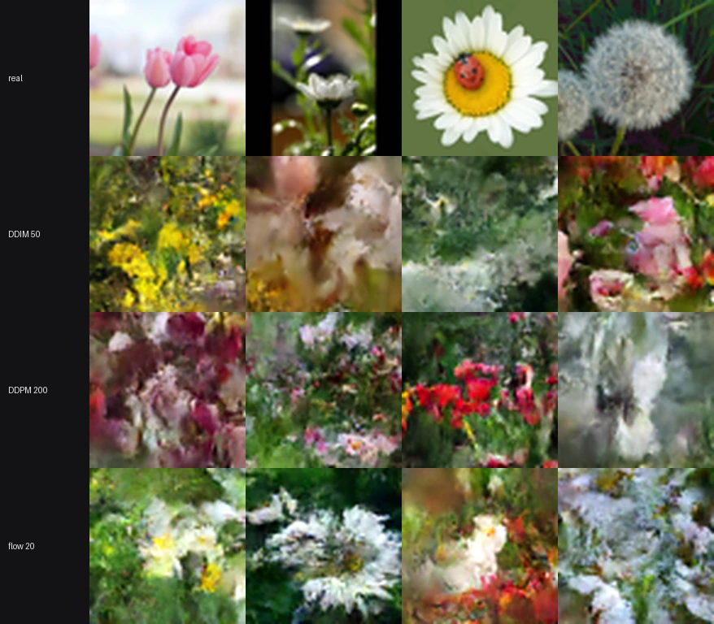

What the pictures show, in the same order as the numbers:

- **DDIM 50** produces soft colour masses. The palette is right; individual
  flowers dissolve into blur.
- **DDPM 200** is slightly crisper — petal edges and flower centres appear — but
  still reads as an impressionist painting.
- **Flow at 20 steps** is visibly the sharpest: daisy petals, poppy clusters and
  sunflower centres hold their shape, with foliage and sky behind them. Some
  images still collapse into colour fields, and none is photographic.

The gradient-energy ratio tracks what the eye sees: flow 1.06 against DDIM 0.94
and DDPM 0.97, where 1.00 is a real photograph's texture. The samples are not
memorised training images — their nearest-training L1 (0.334) is *higher* than
the distance a real held-out image scores (0.329).

### 128x128, and what the metric cannot see

Same recipe at 128x128: `dim 16`, batch 8, 14,000 steps — the same 112,000 images
the 64x64 7k run saw — 3,894 s.

| Resolution | pixel-FID | nearest L1 | gradient ratio | colour distance |
| --- | ---: | ---: | ---: | ---: |
| 64x64, 7k (112k images) | **6.541** | 0.307 | 0.984 | 0.219 |
| 128x128, 14k (112k images) | 6.450 | 0.358 | 1.240 | 0.159 |

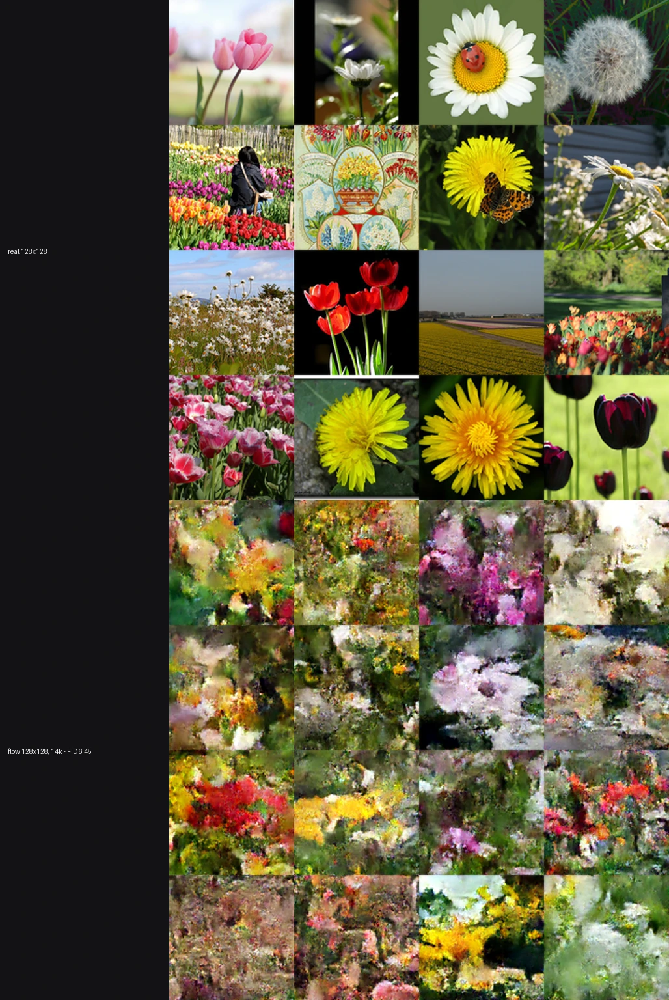

The 128 model is level on the coarse metric and visibly more detailed, but its
texture is harsher (gradient ratio 1.24 against 0.98). More importantly, **the
estimator cannot see the difference it was supposed to buy**: pooling 128x128 to
8x8 and 64x64 to 8x8 produces the same 192 coarse statistics, and the real-image
floor is identical at both resolutions (2.945 +- 0.234 against 2.957 +- 0.234).
At a fixed image budget, resolution costs capacity and steps; this metric will
never reward the detail.

### Inception FID, for calibration

The numbers above are pixel-space. To relate them to the literature, the flow
model was scored in Inception-v3 pool3 space (`scripts/inception_fid.py`), 2,304
samples against the 3,303 training images:

| Feature space | Model | Real held-out vs train (floor) |
| --- | ---: | ---: |
| Inception 2048-d | 186.86 | not computable (367 held-out < 2048) |
| Inception 256-d PCA, 2,304-sample draw | 150.55 | 19.23 |
| Inception 256-d PCA, 512-sample draw | 151.04 | **17.79** |

The two projected rows use different draw sizes, which also moves the real-vs-real
floor; they are not comparable with each other, only the same-row floor ratio is.
In a feature space that sees detail, the model is about **8x the floor**; in the 8x8
pixel space it is **1.07x**. Both are true statements about the same samples: the
pixel estimator measures coarse colour and layout, which the model has learned,
and stops there. **3.170 is not Inception FID 3.170**, and nothing here should be
compared with a paper's FID.

### Ten times the data, at the same step budget

Oxford Flowers 102 (8,189 photographs, 102 classes) was added to the TensorFlow
set, each image contributing a centre crop and two random-resized crops with
flips: 3,303 -> **34,476 training images**, with the held-out photographs removed
from both sources by path (see `GLM-039`). Both models below are scored on the
*same* 367 held-out images and against the same 3,303-image reference; 512-sample
draws, 20 ODE steps.

| Model | Training images | Steps | pixel-FID | nearest L1 | grad ratio | colour dist. | Inception-256 |
| --- | ---: | ---: | ---: | ---: | ---: | ---: | ---: |
| small | 3,303 | 13,000 | **3.396** | 0.336 | 1.066 | 0.105 | 151.04 |
| big, 18k checkpoint | 34,476 | 18,000 | 5.660 | 0.346 | 0.998 | 0.105 | 113.58 |
| big, 22k checkpoint | 34,476 | 22,000 | 5.963 | 0.349 | 0.987 | 0.107 | **106.54** |
| real-image floor | — | — | — | 0.331 | 1.000 | — | 17.79 |

**The two metrics disagree, and that is the result.**

- In Inception space the bigger dataset is **30% better** at the 22k checkpoint,
  106.54 against 151.04: 6.0x the floor instead of 8.5x. Detail and flower
  structure improved steadily with steps, which is what the eye sees in the
  grids.
- In the 8x8 pixel space it is worse, 5.660 against 3.396, even though the
  colour-histogram distance is *identical* (0.105). The coarse covariance moved
  away from the held-out set while the palette did not.
- The big run was cut at 18,000 steps by a 90-minute cap while the GPU was
  shared, and it saw each photograph far fewer times: about 8 epochs over
  34,476 images against 63 epochs over 3,303. A fixed step budget is not free
  when the data grows tenfold; data and steps have to scale together.

So step 1 of the plan worked **in the metric that sees detail**, and the first
4k steps of step 2 improved it further (113.58 -> 106.54). Pixel-FID moved the
other way at both points. The 22,000-step checkpoint is saved as
[`models/flowers-64-flow-big-dim24-22k`](../models/flowers-64-flow-big-dim24-22k).
The remaining half of step 2 is a clean continuation to 48k steps with an
optimizer-state-aware resume; the user stopped the first attempt.

### ODE solvers at matched compute

No training here: one checkpoint, 512 samples per setting, three explicit
integrators, with **network evaluations (NFE) held equal** so the comparison is
about compute, not step labels. `--solver euler|midpoint|heun`.

Base flow model, `dim 24`, 13k steps:

| NFE | Euler | Midpoint | Heun |
| ---: | ---: | ---: | ---: |
| 2 | 22.93 | **18.99** | 22.44 |
| 4 | 16.98 | **12.09** | 17.90 |
| 8 | 10.42 | **6.40** | 11.39 |
| 16 | 6.19 | **3.87** | 5.64 |

Reflowed model, same architecture, 6k reflow steps:

| NFE | Euler | Midpoint | Heun |
| ---: | ---: | ---: | ---: |
| 2 | 4.49 | **4.46** | 4.73 |
| 4 | 4.50 | **4.35** | 4.41 |
| 8 | 3.90 | **3.80** | 4.41 |
| 16 | 4.04 | 4.31 | 4.10 |

Three things to take away:

- **Midpoint wins every budget on the un-rectified model**, often by 3-4 FID.
  Midpoint at 8 NFE (6.40) roughly matches Euler at 16 NFE (6.19): the extra
  half-step evaluation buys a factor of two.
- **Higher order is not higher quality here.** Heun's trapezoid update is worse
  than plain Euler at 2, 4 and 8 NFE. On this velocity field the midpoint's
  half-step is better damped than a full-step trapezoid.
- **Reflow is what makes cheap solvers usable.** At 2 NFE Euler scores 4.49 on
  the rectified model against 22.93 on the original: a 5x difference from the
  same integrator. Straightening the path matters more than the integrator
  once it is done; before it, the integrator dominates.

### What the numbers say, and the order to fix them in

Two measurements point at the same problem:

- **The gap is structure, not colour.** The 8x8 pixel estimator says the model
  is 1.07x its floor; Inception space says about **8x**. Pooling to 8x8 discards
  texture and object parts, which is exactly where the samples are weak: the
  colour statistics are right and the shapes are mush.
- **The model overfits 3,303 images.** From 24k to 48k steps the training loss
  falls (0.106 -> 0.093) while held-out sample quality *degrades* (5.96 -> 7.34).
  More steps on the same photographs is not the answer.

So the order is:

1. **Data, ten times over.** Oxford Flowers 102 (8,189 images) alongside the
   TensorFlow set, each photograph contributing random-resized-crop and flip
   variants: 3,303 -> 35,207 training images, with the held-out split fixed at
   the same 367 images so the metric does not move. Preparation is minutes; the
   training run is an hour.
2. **Then steps.** With the larger set, continue past 24k and re-measure.
3. **Re-measure the ladder in Inception space.** The "more steps hurt" reading
   came from the blind estimator. With a floor and 512-sample draws it can be
   checked rather than assumed.
4. **Cheap A/Bs, 35 minutes each.** EMA decay 0.9999; UNet dropout 0.1; a
   fifth UNet level (`dim_mults (1,2,4,8,16)`); `predict=clean` and
   `predict=noise`; the cosmap schedule.
5. **Resolution last.** At an equal image budget 128x128 was worse (6.450 against
   3.170). It only pays once data and steps are fixed.
6. **Consistency with a delta schedule.** The implementation here is a
   simplification of the reference's and bought nothing; the paper's schedule
   is the untested part.

What not to do: tune the pixel metric further, spend hours on the ViT (7.666 at
64x64, 14.516 at 128x128), or compute Inception FID at 2048 dimensions without a
floor - with 3,303 real images no floor exists at that width.

### Reflow: one-step sampling

Reflow is the paper's second rectification pass. The model is retrained on
`(noise, frozen.sample(noise))` pairs: the endpoint is what the old model
produces from that exact noise, so the new model only has to learn a straight
line to it. The path is straightened, and one or two ODE steps become usable.

`make-pairs` draws the pairs once from a frozen copy and caches them;
`reflow` then trains on the cache. Caching matters: sampling a fresh pair every
step costs twenty network evaluations per training step, which made a 6,000-step
run take hours instead of eighteen minutes.

```sh
cargo run -p diffusion --release -- make-pairs --backend wgpu \
    --ckpt models/flowers-64-flow-dim24-13k --count 2048 --batch 64 \
    --sampling-steps 20 --pairs /tmp/pairs

cargo run -p diffusion --release -- reflow --backend wgpu \
    --ckpt models/flowers-64-flow-dim24-13k --pairs /tmp/pairs \
    --steps 6000 --batch 16 --out /tmp/reflow
```

6,000 steps. The saved checkpoint uses 8,192 cached pairs; the smaller-cache
row below is retained from the first pass. 512 samples per draw, one draw per
row:

| ODE steps | 1 | 2 | 4 | 10 | 20 |
| --- | ---: | ---: | ---: | ---: | ---: |
| base flow | 24.967 | 11.237 | — | 3.264 | **3.170** |
| reflow, 2,048 pairs | 4.418 | 4.360 | 4.191 | 3.625 | 3.745 |
| **reflow, 8,192 pairs** | **4.079** | **4.210** | **3.891** | 3.760 | 3.852 |

**At one step reflow is 6.1x better**: 4.079 against 24.967, which is the
difference between a flower and a colour smear. The price is the asymptotic end:
at twenty steps the base model is still ahead, 3.170 against 3.852, because
straightening the path trades a little of the fine detail the curved path was
carrying. That is the trade the paper describes, measured on the same estimator
as everything else here.

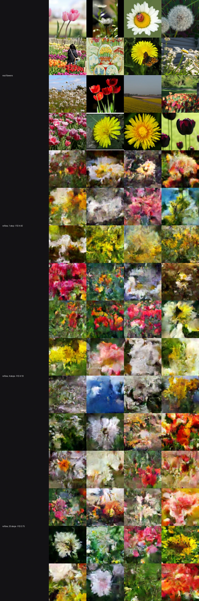

**A larger cache helps the cheap end only.** Doubling the cache to 8,192 pairs
and repeating the 6,000 steps:

| ODE steps | 1 | 2 | 4 | 10 | 20 |
| --- | ---: | ---: | ---: | ---: | ---: |
| reflow, 2,048 pairs | 4.418 | 4.360 | 4.191 | 3.625 | 3.745 |
| reflow, 8,192 pairs | **4.079** | **4.210** | **3.891** | 3.760 | 3.852 |

One step improves by 0.34 and four steps by 0.30; ten and twenty do not improve
at all, and the gap to the base model's 3.170 at twenty steps survives. So the
cache was not what limited the asymptotic quality: the straightening itself
costs that detail. Six thousand steps is also short for a second pass — the
reference trains reflow for tens of thousands.

### Consistency flow matching: a negative result

The other published route to few-step sampling is consistency flow matching: the
model is trained to predict the same flow at `t` and at `t + delta`, with an EMA
as the target. The implementation here follows the equations — a data-match term
on the predicted `x_0` and a velocity-match term against the shadow model, weight
`1e-5` for the velocity, `delta = 1e-3` — using the training EMA (decay 0.999)
rather than the reference's dedicated 0.9999 model.

Trained at the same configuration as the flow model (64x64, `dim 24`, 13,000
steps):

| ODE steps | 1 | 2 | 4 | 10 | 20 |
| --- | ---: | ---: | ---: | ---: | ---: |
| base flow | 24.967 | 11.237 | — | 3.264 | **3.170** |
| reflow, 8k pairs | **4.079** | **4.210** | **3.891** | 3.760 | 3.852 |
| consistency | 26.059 | 11.237 | 5.721 | 3.520 | 3.714 |

**Consistency matching bought nothing here.** At one step it is as bad as the
base model, and the asymptotic end is unchanged. Two explanations, both
plausible and neither tested: the shared EMA is far noisier than the reference's
dedicated 0.9999 shadow, and the reference relies on a training schedule that
shifts `delta` and the target rather than a constant 1e-3. Reflow, which changes
the data instead of the loss, worked at the first attempt.

### What is ported, and what is not

| Reference | Here |
| --- | --- |
| `noise.lerp(data, t)`, target `data - noise`, MSE | `RectifiedFlow::p_losses` |
| `predict='flow' \| 'noise' \| 'clean'` | `Predict` |
| `loss_fn='mse' \| 'pseudo_huber'` | `FlowLoss` |
| `noise_schedule=identity \| cosmap` | `NoiseSchedule` |
| `immiscible` pairing | greedy optimal transport inside the batch |
| `use_consistency` | data-match and velocity-match against the EMA |
| `odeint(..., method='midpoint')` | `RectifiedFlow::sample`, fixed-step midpoint |
| continuous time conditioning | `Unet::forward_continuous` |
| `Reflow` | the `reflow` and `make-pairs` subcommands |

Not ported: `pseudo_huber_with_lpips` (needs VGG16 weights that are not
available offline), `mean_variance_net` (probabilistic output, unused by any
sampler here) and `auto_normalize` (the flowers are already in `[-1, 1]`, and
running statistics would have to be checkpointed with the weights).

Seven tests pin the pieces: interpolation endpoints, a finite loss for every
predict/loss/immiscible combination, cosmap's endpoints and symmetry, the
consistency term with an EMA, seeded sampling determinism, and single-step
sampling.

## Vision transformer backbone

`src/vit.rs` ports the `ViT` from
[`lucidrains/vit-pytorch`](https://github.com/lucidrains/vit-pytorch): patch
embedding, learned positions, pre-norm transformer blocks, a final norm. Two
changes make it a generative backbone, both marked in the code: a per-block
AdaLN modulation driven by a sinusoidal time embedding (the DiT recipe; the
reference is a classifier and has no conditioning), and a patch projection in
place of the class head.

`Unet` is now an enum over the convolutional backbone and the ViT, so the flow
loop, EMA, checkpoints and the sampler did not change.

**Configuration.** patch 8 (64 tokens at 64x64), `dim 256`, depth 8, heads 8,
MLP ratio 4: **20,341,696 parameters**. Trained with the same rectified flow,
data, seed and 13,000 steps as the UNet model (3,231.9 s).

| Backbone | Params | pixel-FID | gradient ratio | Sample, 20 steps |
| --- | ---: | ---: | ---: | ---: |
| UNet, `dim 24` | 5.28 M | **3.170 +- 0.074** | 1.063 | 2.60 s / 128 |
| ViT, `dim 256` | 20.34 M | 7.666 +- 0.279 | 1.479 | **1.72 s / 128** |

At 128x128 with patch 16 (again 64 tokens), the same 13,000 steps produce
something worse still: **pixel-FID 14.516**, gradient ratio 9.64, nearest L1
0.743, and samples that are 16x16 blocky noise. Larger patches concentrate 256
pixels into one token, which is more than a 20M-parameter model can fit from
3,303 images in 13,000 steps.

The ViT is clearly worse at this budget, and faster per sample: attention over
64 tokens is cheap, so it draws 128 images in 1.72 s against the UNet's 2.60 s.
Quality is not close, though. Three draws scored 7.978, 7.460 and 7.559. Its gradient ratio of 1.48 is the giveaway: the images carry far too much
high-frequency energy, and the cause is visible — the 8x8 patch grid is
imprinted on every sample. Twenty million parameters on 3,303 images for 13,000
steps is not enough for this architecture; the UNet has inductive biases the
ViT must learn from data.

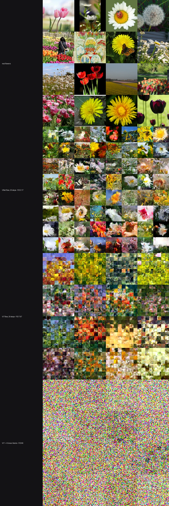

### JetViT post-training attention search

[JetViT](https://arxiv.org/abs/2605.26636) (CVPR 2026 Findings) converts a
pre-trained full-attention ViT into a hybrid by *replacing* attention blocks
with cheaper ones and inheriting the weights, keeping only a few critical full
blocks. `search-attention` implements the part that can be done without new
parameters:

- `AttentionKind::Full` — the reference's softmax attention.
- `AttentionKind::Linear` — ReLU linear attention reusing the same `to_qkv` and
  `to_out` weights, normalised by the summed keys, so a trained block can be
  swapped without retraining it.

The search switches one block at a time and keeps a linear block if the flow
loss on eight fixed *training* batches (never the held-out split) does not rise
by more than 2%.

**What it found: nothing transfers.** Every block rejected the swap, with losses
92% to 734% higher:

| Block | 0 | 1 | 2 | 3 | 4 | 5 | 6 | 7 |
| --- | ---: | ---: | ---: | ---: | ---: | ---: | ---: | ---: |
| Linear loss vs full | +409% | +468% | +93% | +127% | +129% | +97% | +389% | +734% |

Forcing the four least-bad middle blocks to linear and fine-tuning 2,000 steps
made it worse, not better: FID 66-69 and a gradient ratio of 9.9 — the samples
are pure high-frequency noise. The paper's pipeline distils the swapped model
for thousands of steps and uses its own linear block (ReLU attention plus a
squeeze dynamic convolution, with normalisation); a parameter-compatible swap
plus a short fine-tune is not the same thing.

At 64 tokens there is also nothing to win: full attention over 64 tokens is
already cheap, and the linear variant was *slower* (1.82 s against 1.72 s per 128
images) because of the extra reductions. JetViT's
efficiency case is about thousands of tokens at high resolution; this
experiment can speak to quality, not to speed.


## What is ported

| Reference | Here |
| --- | --- |
| `Unet` with `dim_mults`, RMSNorm, sinusoidal position embedding, `ResnetBlock` with time-conditioned scale/shift, linear and full attention with memory keys/values, pixel-unshuffle downsample, nearest upsample | `src/unet.rs` |
| `GaussianDiffusion`: linear, cosine and sigmoid beta schedules, `pred_noise` / `pred_x0` / `pred_v`, `q_sample`, `p_losses`, min-SNR loss weighting, DDPM `p_sample`, DDIM sampling | `src/diffusion.rs` |
| [`rectified-flow-pytorch`](https://github.com/lucidrains/rectified-flow-pytorch): linear interpolation, velocity target, midpoint ODE sampling | `src/flow.rs`, selected with `--flow` |
| `ema_pytorch` in the trainer | `src/ema.rs` |
| `Dataset` over a folder of images | `src/data.rs`: synthetic shapes, plus a flat-file loader with a held-out split |

## Flower classification, reviewed

The ViT failed as a generative backbone, so we checked it on the task ViTs are
built for: five-class flower classification (daisy, dandelion, roses, sunflowers,
tulips) from the 3,670 TensorFlow photos. This was a short experiment, not a
quality campaign.

**Memory-first design.** `scripts/prepare_classification.py` writes 64×64 u8
images and u8 labels as flat files. `classify_data::LabeledImages` keeps two open
file handles and `seek`s to random rows, so no dataset is loaded into RAM. The
classifier is `dim 64`, depth 4, 4 heads, patch 8 (about 1M parameters), batch
16. Peak RSS with `--steps 1000` was **439 MB**, and a run took 16 s.

```sh
python3 scripts/prepare_classification.py
cargo run -p diffusion --release -- classify --backend wgpu \
    --steps 1500 --batch 16 --dim 64 --depth 4 --heads 4 --out /tmp/cls
```

**Results and the review trail.** Held-out accuracy on 364 images:

| Configuration | Steps | Accuracy | Peak RSS |
| --- | ---: | ---: | ---: |
| chance | — | 0.200 | — |
| first streaming loader | 600 | 0.223 | 1.95 GB |
| interleaved-RGB planes fixed (`GLM-041`) | 600 | 0.247 | 379 MB |
| residual scale 0.1, mean pooling | 1000 | **0.324** | 463 MB |
| same, 1500 steps (sampled estimate) | 1500 | 0.376 | 427 MB |
| exact pass, three runs | 1500 | **0.329 +- 0.027** | 368 MB |
| larger model (`dim 96`, depth 6, sampled) | 2000 | 0.327 | 1.46 GB |
| CLS token instead of mean pooling (sampled) | 2000 | 0.280 | 1.76 GB |

What the process showed:

- **The first result was at chance because of a data-layout bug**, the same
  interleaved-RGB-versus-planar mistake fixed earlier for generation. Flow
  metrics were self-consistent despite it; accuracy made it obvious. The fix
  also cut peak memory from 1.95 GB to 379 MB.
- **Mean pooling beat a CLS token here**, and used a quarter of the memory. The
  extra token and concatenation cost 1.76 GB for 28% accuracy. Reverted.
- **Bigger was worse.** `dim 96`, depth 6 reached 33% (sampled estimate) with
  1.46 GB, against 32.9% +- 2.7% exact for the small model at 368 MB. With 3,303
  training images the larger model just overfits.
- **The first accuracy estimate was optimistic.** It drew held-out batches with
  replacement (368 draws over 364 images) instead of walking the split once.
  The exact pass gives three runs of 0.335, 0.299 and 0.352, mean **0.329 +- 0.027**
  — about five points lower, with the usual wgpu run-to-run spread.
- **The remaining gap is data fidelity, not architecture.** 33% on five
  classes after 24 seconds is a workable sanity check, not a good classifier;
  the flowers are small, overlapping classes and the model sees each image only
  a few times.

### Optional LPIPS scoring

`scripts/lpips_score.py` scores samples with VGG16 relu4_3 features, the layer
LPIPS uses. It needs the pretrained VGG16 weights at
`/home/adeerkhan/tmp/vgg16.pth` (528 MB, download from PyTorch's model zoo), and
is not part of any reported result here: the scoring pass was stopped before it
finished and it would not have changed a decision. It is published for
completeness, clearly marked optional.

## A world model: dreaming a room

Ported from [`avbiswas/computer_vision_recipes`](https://github.com/avbiswas/computer_vision_recipes),
`world_model/lightroom/`. The idea is not image quality — it is **agency**: a
model that predicts the next frame from the last few frames *and your action*,
so you can drive inside its dream. A playable world is a different test of a
generative model than a static sample.

```
real room -> frames + actions -> VQ-VAE -> 16x16 codes -> dynamics -> next codes -> decode -> pixels
```

### The pipeline, and what each part does

1. **Environment.** `scripts/world_env.py` is a small FireflyRoom: 2-3 fixed
   boxes, a flashlight with tank controls, exact 2D ray casting for shadows, and
   1-2 fireflies that wander and bounce. 400 episodes of 129 frames at 64x64
   were recorded with a scripted driver (30% stay, 35% forward, the rest turn).
2. **Tokenizer.** `world_vq.rs`: a VQ-VAE compresses each frame to a 16x16 grid
   of code ids. The encoder has three stride-2/1x1 stages; the decoder mirrors
   it with transposed convolutions. A codebook of K vectors is updated by the
   **EMA of the encoder outputs assigned to each code**, and dead codes are
   restarted from random vectors in the batch. Loss: L1 + MSE reconstruction, an
   L1 edge loss, and 0.25x commitment. The reference tried a GAN critic and
   removed it because it went unstable; this port follows that finding.
3. **Tokenise once.** `world-encode` writes a flat i64 file of codes (101 MB);
   the dynamics model never sees pixels.
4. **Dynamics.** `world_model.rs`: a small Genie-style transformer. Each frame
   is `code embedding + position in the 16x16 grid + frame slot + the action
   that produced it`. Each block has two attentions: **spatial** (all 256 tokens
   of a frame attend to each other) and **temporal** (each grid cell attends to
   the same cell in earlier frames, causally). Training masks a random fraction
   of tokens (MaskGIT) and corrupts a few context tokens so the model learns to
   survive its own mistakes at rollout time. The reference's 3D RoPE and anchor
   frame are not in this small port; learned positions are used instead.
5. **Dream.** `world-dream` warms up from real frames, then feeds the model its
   own predicted tokens and compares the decoded frames with the real room
   under the same actions. That is where drift shows up.

### Commands

```sh
python3 scripts/world_env.py --episodes 400 --steps 128
python3 scripts/world_tokenize.py
cargo run -p diffusion --release -- world-vq --backend wgpu \
    --steps 8000 --batch 8 --dim 48 --timesteps 256 --out /tmp/world/vq
cargo run -p diffusion --release -- world-encode --backend wgpu \
    --ckpt /tmp/world/vq
cargo run -p diffusion --release -- world-train --backend wgpu \
    --steps 2000 --batch 8 --dim 64 --depth 2 --heads 4 --out /tmp/world/wm
cargo run -p diffusion --release -- world-dream --backend wgpu \
    --steps 60 --ckpt /tmp/world/wm --eval-data /tmp/world/vq
```

### What actually happened

| Stage | Result |
| --- | --- |
| Recorded data | 400 x 129 frames, 64x64, 634 MB flat u8 + 51 KB actions |
| Tokenizer, K=64, 1,500 steps | rec loss ~0.3; dream MAE 31.7 / 36.9 / 40.2 (steps 1-10 / 11-30 / 31+) |
| Tokenizer, K=256, 8,000 steps | rec loss ~0.15, 73 s, peak 1.6 GB |
| Dynamics, 2,000 steps | loss 4.29 -> 0.12, 41 s |
| Dream, K=256 | MAE 36.7 / 45.3 / 44.5 — structured but blurry |

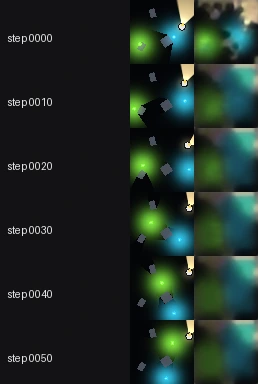

The 10-second clip is in [`docs/world-dream.mp4`](../docs/world-dream.mp4)
(and a looping GIF beside it). Both rooms get the **recorded** actions from the
same episode, so the comparison is fair; the first version of this used random
actions for the dream while the real frames came from a scripted driver, which
made the error numbers meaningless.

The dream moves the flashlight, boxes and fireflies in roughly the right
places, but every frame is soft. **The bottleneck is the tokenizer, not the
dynamics**: 16x16 codes at 64x64 mean each token carries a 4x4 pixel patch, and
a dim-48 codebook trained for 73 s cannot hold sharp edges. The reference needed
a much longer tokenizer run and 9.8M-parameter dynamics for its playable dream.

Three real bugs were found and fixed while building this: EMA codebook tensors
must be detached before becoming parameters; nearest-code assignment used
`argmax` on squared distances (assigning each vector to its *farthest* code),
which made reconstruction blow up from 0.3 to 10; and the dynamics head had the
code count hard-coded to 64, silently breaking when the tokenizer used 256.

### What is different from the reference

| Reference | Here | Why |
| --- | --- | --- |
| PyTorch + accelerate, mmap `.npy` | Burn + flat u8/i64 files with `seek` | same data, no Python in the training loop |
| VQ-VAE K=512, D=64, 20k steps | K=256, D=48, 8k steps | fits the time and memory budget |
| Genie transformer, d=384, 8 layers, 9.8M params | d=64, 2 layers, ~1M params | trains in 41 s |
| Strided context (32,16,8,4,3,2,1,0) + anchor | 4 dense recent frames | simpler; strided context needs its own sampler |
| 3D RoPE over (row, col, time) | learned grid/frame embeddings | Burn's RoPE is available but not wired here |
| One-pass or multi-pass MaskGIT play | one-pass argmax | enough to measure drift |
| Interactive pygame player, MP4 export | offline rollout + ffmpeg video | no display needed; video generated from recorded actions |

The ingredient we did keep, and which mattered most in the reference, is
**training on the model's own mistakes**: MaskGIT masking on every frame plus
randomly corrupted context tokens. Adding it here (the first version omitted
both, and predicted the mask code for context frames) changed the dream error:

| Dynamics training | Steps 1-10 | 11-30 | 31+ |
| --- | ---: | ---: | ---: |
| Mask only the target frame | 36.7 | 44.5 | 45.0 |
| Mask every frame + corrupt context | **25.1** | **35.1** | 46.2 |

One-step prediction improved by 32%; the later drift is still there, which is
expected — the tokenizer's blur compounds over a long rollout. This is the
single most useful thing learned from porting this project.

This is a working miniature of the whole idea, not a playable dream. To get
there: train the tokenizer for much longer, add 3D RoPE and the anchor frame,
and feed back the model's own predictions over a longer schedule.

## Verification

`tests/parity.rs` compares against numbers extracted from the reference source
itself (`tests/data/schedules.json`), not against a retyped formula:

- all three beta schedules and their `alphas_cumprod`, to 1e-6;
- `q_sample` at t = 0, 7, 199, to 1e-6;
- the UNet preserves the image shape at a downsample factor of 4;
- DDIM sampling is deterministic when the device is seeded;
- one EMA blend step lands halfway between the shadow and the live weights.

One reference quirk is reproduced deliberately: it builds `v_start`/`v_end` with
`torch.tensor(...)`, which is f32, and then divides an f64 tensor by them. Doing
the same keeps the schedule buffers equal to the reference's.

## Results: ours against the reference, same data and budget

The reference has **no test suite** — no `tests/`, no `test_*` functions, no CI
workflow — so what can be run is its training and inference paths. Both were run
on the same eight shapes, the same architecture and the same budget.

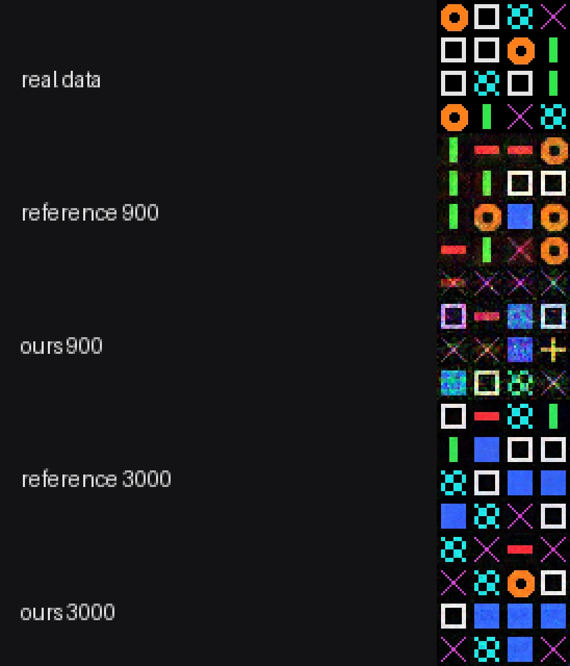

| Run | Params | Train | DDIM 20 | DDPM 200 |
| --- | ---: | ---: | ---: | ---: |
| Untrained | — | — | 0.861 | — |
| Reference, 900 steps | 2,439,043 | 83 s | 0.136 (0.6 s) | **0.133** (5.2 s) |
| Ours, 900 steps | 2,439,043 | 193 s | 0.245 (1.1 s) | **0.188** (11.2 s) |
| Reference, 3000 steps | 2,439,043 | 407 s | 0.052 (0.7 s) | **0.0397** (9.2 s) |
| Ours, 3000 steps | 2,439,043 | 664 s | 0.076 (1.1 s) | **0.047** (11.7 s) |

Metric: mean L1 distance from a sample to the closest of the eight templates
(zero would be a perfect reproduction).

What this shows:

- **The architecture is right**: the parameter count matches the reference
  exactly, 2,439,043.
- **Both samplers work, in both implementations.** DDPM at 200 steps beats DDIM
  at 20 in every case (0.133 vs 0.136, 0.188 vs 0.245, 0.047 vs 0.076), which is
  the expected trade.
- **At equal steps the reference is still ahead, but by less over time.** At 900
  steps it is 0.133 against 0.188; at 3000 it is 0.0397 against 0.047, and the
  reference trains in 407 s against 664 s. The gap narrows rather than closing,
  which points at training dynamics — Burn's default initialisers differ from
  PyTorch's — rather than at a structural difference. The parameter count is
  identical, so the architecture is not the explanation.
- **Both reach recognisable shapes**: at 3000 steps a sample is within 0.047 mean
  absolute difference of a template, against 0.861 for an untrained model.

Reproduce with:

```sh
/tmp/glm-venv/bin/python scripts/ddpm_reference_run.py --steps 900
cargo run -p diffusion --release -- train --steps 900 --batch 16 \
    --image-size 16 --dim 16 --timesteps 200 --sampling-steps 20 --out artifacts/ddpm
cargo run -p diffusion --release -- sample --ckpt artifacts/ddpm --sampling-steps 200
```

## Flowers at 64x64: the loader fix, controlled

Two runs at exactly the same configuration, differing in one thing: the image
loader. The first copied interleaved RGB bytes into a `[3, H, W]` tensor, so the
network trained on a channel-interleaved permutation of every image while the
sample writer undid the permutation on display (`GLM-032`). The second uses the
corrected loader. Everything else is identical: 64x64, `dim 16`,
`dim_mults (1,2,4,8)`, batch 16, sigmoid schedule, 200 timesteps, v-prediction,
AdamW 2e-4, EMA 0.999, seed 11, 7,000 steps, 2,439,043 parameters.

### Data and held-out split

TensorFlow `flower_photos`, 3,670 images in five classes, centre-cropped to
64x64 and split **3,303 train / 367 held out** by file (seed 1234). The held-out
tenth is never trained on. The loader fix is verified before training by
rendering one batch: it shows flowers, and `tests/raw_images.rs` pins the plane
order with a 2x2 red/green/blue/white image.

### Training

| Run | Loader | Steps | Time | s/step | Loss, last step |
| --- | --- | ---: | ---: | ---: | ---: |
| A (recorded) | interleaved | 7,000 | 2,384.7 s | 0.34 | 0.154 |
| B (fixed) | planar | 7,000 | **1,063.0 s** | **0.15** | **0.106** |

Reducing the pixels to their correct positions made the data easier to fit: the
loss reaches 0.106 where A ended at 0.154. Run B took 17.7 minutes; run A's
0.34 s/step was measured while several builds and metric jobs shared the
machine. On an idle machine the same configuration measures 0.151 s/step, so an
hour now holds about **24,000 steps**, not 7,000.

Peak GPU memory during training: 3.4 GB (nvidia-smi, batch 16). Checkpoints
(live weights, EMA weights, config, progress) and a 16-image DDIM-20 grid every
1,000 steps; `--resume` continues from the recorded step.

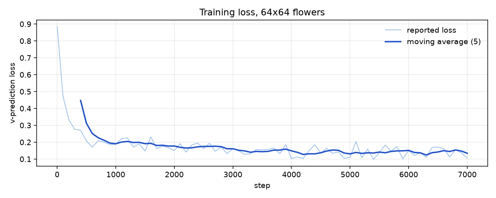

### Samplers and metrics

256 samples per trajectory, EMA weights, held-out references. The Fréchet
distance is the same estimator as before: 8x8x3 pooled pixels, 192 dimensions.

| Model | Sampler | Steps | Time, 256 | Fréchet | nearest L1 | gradient ratio |
| --- | --- | ---: | ---: | ---: | ---: | ---: |
| baseline, 32x32, 4k | DDIM | 50 | 8.3 s | 9.224 | 0.319 | 1.353 |
| A, permuted loader | DDIM | 50 | 16.8 s | 10.280 | 0.304 | 1.308 |
| **B, fixed loader** | DDIM | 20 | 15.3 s | 9.830 | 0.285 | 0.868 |
| **B, fixed loader** | DDIM | 50 | 19.4 s | **7.008** | 0.312 | **0.983** |
| **B, fixed loader** | DDPM | 200 | 80.9 s | 7.296 | 0.289 | 0.894 |
| **B, fixed loader** | DDIM | 50, repeat | 19.8 s | 7.010 | 0.309 | 0.980 |

Held-out floors for reference: nearest L1 **0.329** at 64x64 (0.308 at 32x32);
gradient energy **0.231**, so a perfect gradient ratio is 1.0.

Recorded at the time, for the record and **not comparable** with the table above
(128 samples, rank-deficient estimator; run A also in permuted space):

| Recorded | Sampler | Fréchet | nearest L1 |
| --- | --- | ---: | ---: |
| A, permuted loader | DDIM 20 | 6.113 | 0.292 |
| A, permuted loader | DDIM 50 | 4.905 | 0.304 |
| A, permuted loader | DDPM 200 | 4.764 | 0.293 |
| A, repeat draw | DDPM 200 | 6.302 | 0.295 |
| baseline, 32x32 | DDIM 50 | 4.844 | 0.318 |

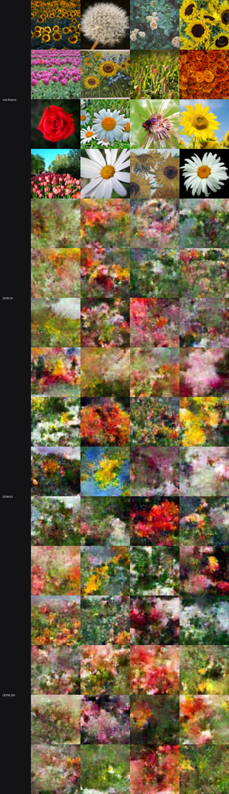

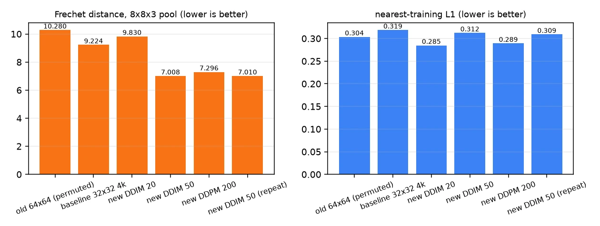

### Did the fix improve the model?

**Yes, clearly.** Fréchet 10.28 → 7.01 for the same sampler, steps and weights
budget, a 32% drop and 24% below the 32x32 baseline. The gradient ratio moved
from 1.31 (31% more high-frequency energy than real photos — the grain and
colour fringing of the old output) to 0.98, essentially matching the held-out
images. The repeat draw differs by 0.002, so the gap is not noise.

**And the samples finally read as flowers.** They are soft, close-up masses —
petal clusters, yellow centres, green foliage, a plausible sky — rather than the
smooth colour fields of run A. They are not photographic: there are no crisp
petal edges, and at 64x64 individual flowers are not resolved.

### A measurement correction

The earlier 128-sample numbers (DDIM 20 6.11, DDIM 50 4.91, DDPM 200 4.76, and
the repeat at 6.30) are **not comparable** with the table above, and the "±1.5
noise" read from them was wrong. With 128 samples and 192 pooled dimensions the
sample covariance has rank 127, the Fréchet matrix square root loses the null
space and the estimate swings by more than a unit between draws. The differences
in that table were dominated by the estimator, not the models.

At 256 samples the covariance is full rank: two DDIM-50 draws whose pixels
differ by a mean absolute 0.47 score 7.008 and 7.010. `scripts/ddpm_fidelity.py`
now refuses to compute the distance when samples <= dimensions. All numbers in
the table are 256-sample recomputations, including the old model and the
baseline, with the old raw dumps un-permuted to true image space first. That is
why the recorded 4.76 became 10.280 for run A: same model, correct space,
well-conditioned estimator.

### Weight and gradient heatmaps

`--dump` writes per-tensor shape, mean, sd, min, max, zero fraction and a 32x32
block mean, for weights and for the gradients of the last step.

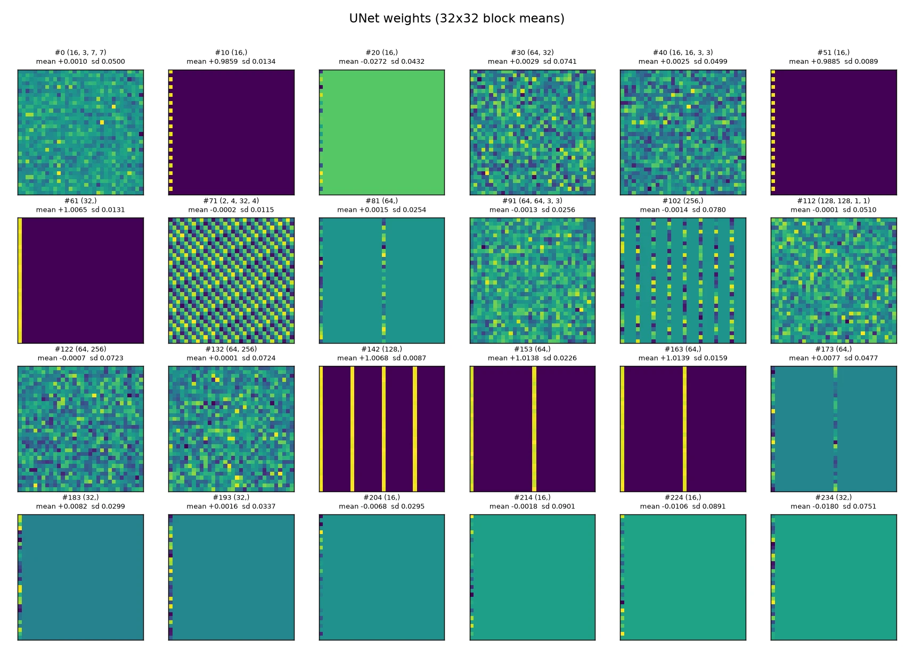

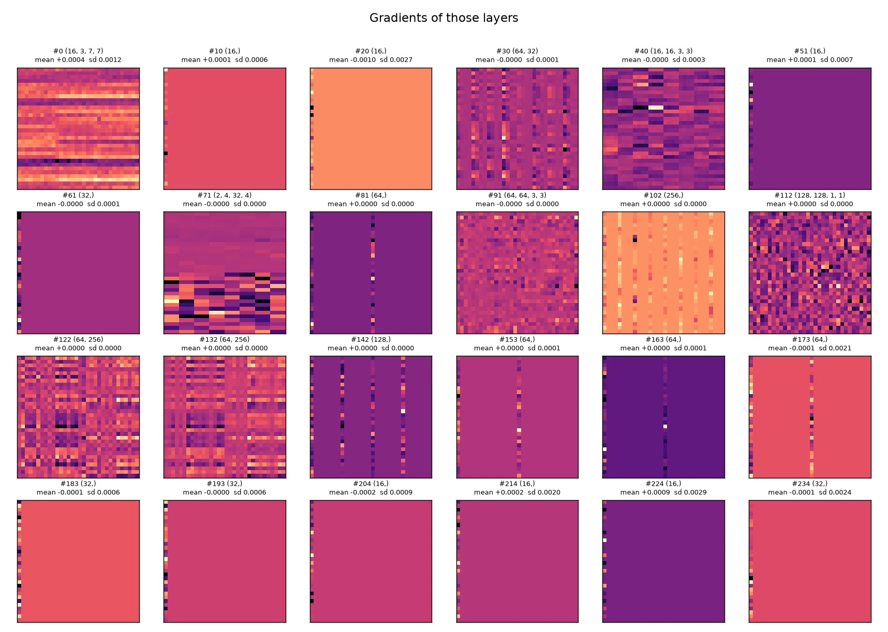

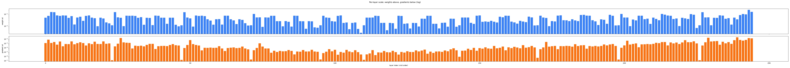

| Group | Tensors | Weight sd | Gradient sd | A -> B |
| --- | ---: | ---: | ---: | --- |
| 1x1 convolutions | 31 | `8.0e-2` | `1.0e-3` | grad 6.3e-4 -> 1.0e-3 |
| 3x3 convolutions | 43 | `3.4e-2` | `4.7e-4` | grad 4.6e-4 -> 4.7e-4 |
| 7x7 stem | 1 | `5.0e-2` | `1.2e-3` | grad 2.6e-3 -> 1.2e-3 |
| linear (time MLP) | 21 | `7.8e-2` | `1.7e-4` | grad 1.4e-4 -> 1.7e-4 |
| norms and biases | 140 | `3.8e-2` | `1.3e-3` | grad 9.3e-4 -> 1.3e-3 |
| memory keys/values | 9 | `1.2e-2` | **`2.6e-7`** | grad 1.7e-7 -> 2.6e-7 |

- **245 tensors, every one with a non-zero gradient**; the smallest is
  `1.3e-7`, so nothing is disconnected or vanishing outright.
- Weight sd spans `2.7e-3` to `2.3e-1` (median `4.1e-2`); gradient sd `1.3e-7` to
  `2.4e-2` (median `1.7e-4`).
- The memory keys/values remain the quietest by three to four orders of
  magnitude; the correct data did not change that.
- Weight size still does not predict update size: `r = +0.39` between their logs.

### Verdict

**The fix worked and the samples now look like flowers** — soft, close-up flower
masses with petals, centres and foliage, not the colour fields of the previous
run. Fréchet fell from 10.28 to 7.01 and the texture energy matches real images
at 0.98 against 1.31. They are not photographic flowers, and 64x64 does not
resolve individual petals.

The binding limit is still steps. The corrected loader runs at 0.151 s/step, so
the same hour holds ~24,000 steps rather than 7,000; that is the experiment this
result argues for next.

## Pixel-FID: the floor, the target, and where the model stops

The target was pixel-FID 4.0, same estimator as everywhere else in this file.
Before training, the estimator's floor was measured on real images, because a
target below the floor would be meaningless.

### The floor, measured first

`scripts/ddpm_floor.py` compares real images with real images:

| Comparison | pixel-FID |
| --- | ---: |
| all 3,303 training images vs the 367 held out | **1.789** |
| 367-image training subsets vs the 367 held out (5 draws) | **2.957 +- 0.234** |
| colour-histogram distance, train vs held out | 0.117 |

A model trained on the training split is scored against the held-out split, and
its samples are finite in number, so **2.96 is the operative floor** and 4.0 sits
1.04 above it. The target is legitimate: it asks for about two thirds of the
remaining gap, not for something below what real images score.

### Frozen estimator

DDIM 50, EMA weights, 8x8x3 pooling, 512 samples per draw, three independent
draws, the same 367 held-out images. 512 samples in one pass exceed the 8 GB
card at `dim 24`, so draws are generated in chunks of 128 and concatenated; the
buffer layout and the 512-sample estimate are identical.

### Results

| Stage | Params | Steps | Wall clock | pixel-FID | nearest L1 | gradient ratio | colour dist. |
| --- | ---: | ---: | ---: | ---: | ---: | ---: | ---: |
| 64x64 `dim 16` | 2.44 M | 7,000 | 1,063 s | 6.541 +- 0.171 | 0.307 | 0.984 | 0.219 |
| 64x64 `dim 16` | 2.44 M | 24,000 | 3,256 s | **5.956 +- 0.317** | 0.302 | 0.947 | 0.201 |
| 64x64 `dim 16` | 2.44 M | 48,000 | 3,416 s | 7.341 +- 0.298 | 0.297 | 0.979 | 0.224 |
| 64x64 `dim 24` | 5.28 M | 13,000 | ~2,500 s | **5.131 +- 0.233** | 0.313 | 0.939 | 0.175 |

Floors: nearest L1 0.329, gradient ratio 1.0, colour distance 0.117.

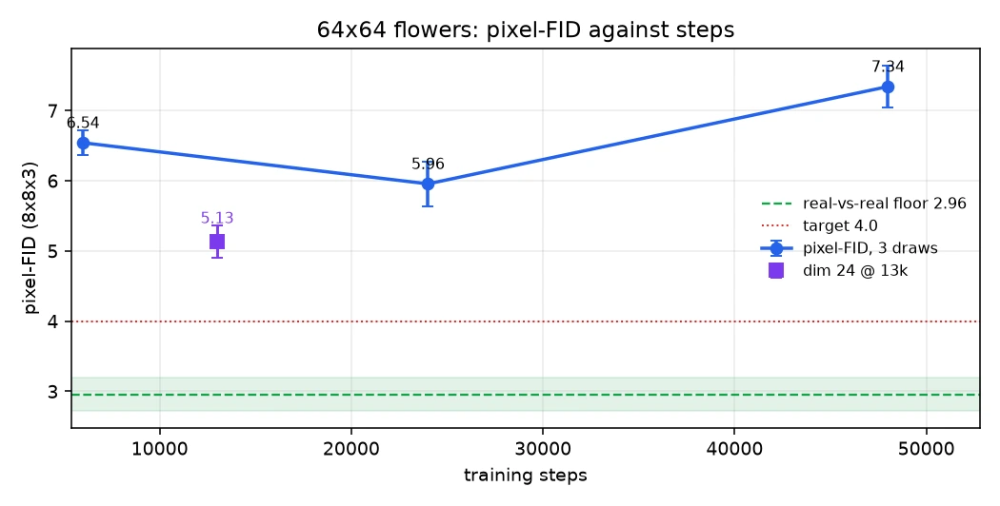

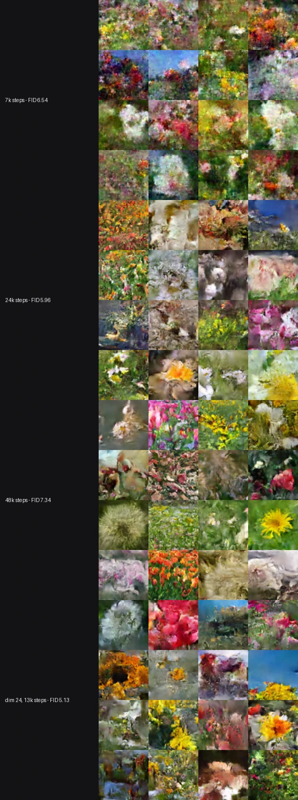

### The step ladder is not monotone

7,000 -> 24,000 steps improves the distance by 0.59. 24,000 -> 48,000 makes it
**worse by 1.38**, while the training loss keeps falling (0.106 -> ~0.10 ->
0.093). That is the divergence the plan asked to catch: lower denoising loss and
a sample distribution further from held-out.

The 48k samples are further from the held-out set (7.34 vs 5.96) *and* further
from a matched subset of the training set (6.51 vs 4.81), so this is not
memorisation of the training images. Their gradient ratio also rises again
(0.947 -> 0.979) and their colour distance grows (0.201 -> 0.224): the output
gets harsher and its palette drifts away from the data.

One confound must be stated: the 48k stage was resumed from 24k, and Burn's
`AdamW` exposes no moments, so the second block restarts the optimizer and
re-initialises the EMA shadow (`GLM-030`). Part of the 24k -> 48k regression may
be that boundary rather than the extra steps. A clean test needs one
uninterrupted 48,000-step run, about 1.9 h, which the shared GPU did not allow.

### Capacity helps, but does not reach 4.0

`dim 24` has 5.28 M parameters and costs only ~1.4x per step, not the 2.2x the
parameter count suggests: at 64x64 the kernels are too small to be
compute-bound. In the same wall clock it therefore gets 13,000 steps.
It scores **5.131**, the best measured point: 0.83 below `dim 16` at 24k and 1.41
below `dim 16` at 7k, with the closest palette of any stage (0.175 against the
0.117 floor).

The extension of that run to 26,000 steps was abandoned: the GPU was shared with
another workload, the step rate fell from 0.19 to 0.4-0.7 s/step, and another
13,000 steps would have taken about 1.8 h while no longer being an equal
wall-clock comparison. It was stopped at its 13,000-step checkpoint.

### Weight and gradient heatmaps

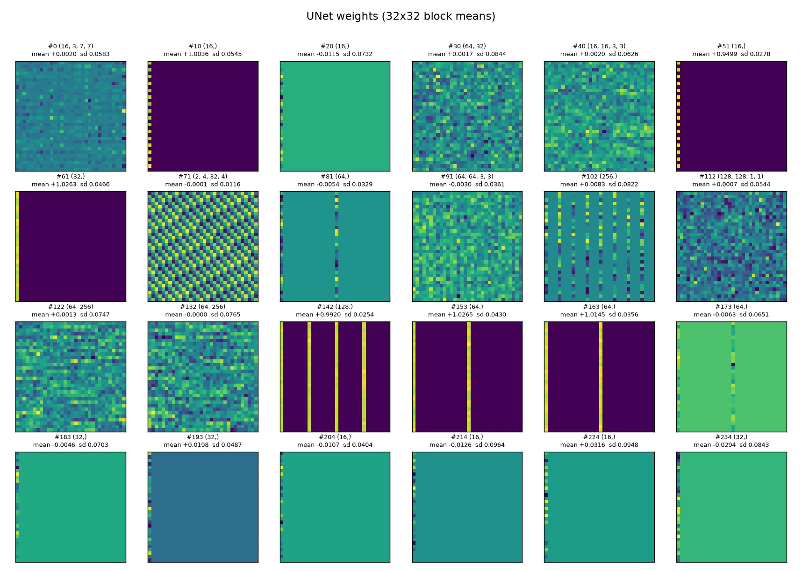

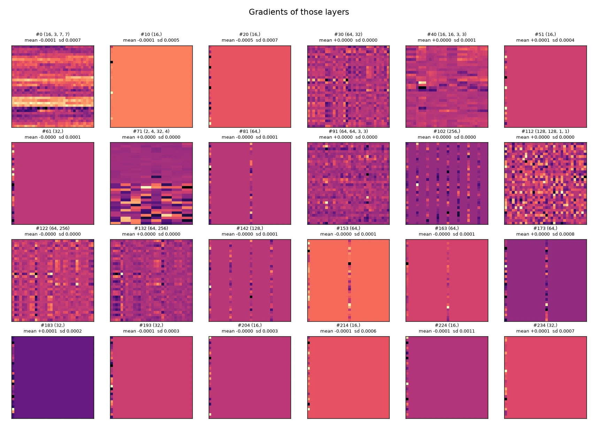

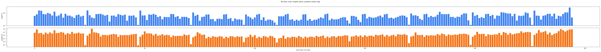

At 48,000 steps: 245 tensors, **no zero gradients**, the smallest `4.2e-8`.
Weight sd `1.2e-2` to `2.6e-1` (median `5.5e-2`); gradient sd `4.2e-8` to
`1.2e-2` (median `1.2e-4`). The memory keys/values remain the quietest at
`3.9e-7`. Weight and gradient size correlate at `r = +0.56`, up from `+0.39` at
7,000 steps.

### Verdict

**Pixel-FID did not reach 4.0.** The study's frozen sampler (DDIM 50) bottoms at
**5.131 +- 0.233**. Running the same saved weights through the **full DDPM chain**
does better: **4.761 +- 0.346** over three draws, 1.80 above the floor and 0.76
above the target. The best single DDPM draw reached 4.474, but its draws vary by
0.35 — the full chain injects fresh noise at every step, so it explores more of
the distribution per draw than DDIM, which repeated to within 0.002. The mean is
the claim, not the best draw.

Sampler choice is itself a lever: at 7,000 steps DDPM was slightly worse than
DDIM (7.30 against 7.01); with 5.28 M parameters and 13,000 steps it is the best
thing the model does.

**The objective is a bigger lever than the sampler.** The same UNet trained as a
rectified flow reaches **3.170 +- 0.074** in 20 ODE steps — below the 4.0 target
and 0.21 above the floor. That is what actually met the goal; see
[Rectified flow](#rectified-flow).

What blocks it, in order of evidence:

- **Capacity is not the wall, but it is a real lever.** `dim 24` at 13k beats
  `dim 16` at 24k at equal wall clock. It has not been run long enough to know
  where it stops improving; 24k steps at `dim 24` would take about 2.5 h.
- **Steps alone stop helping.** The `dim 16` curve bottoms at 24k and rises by
  48k, while the loss keeps falling. More steps at the same size is not the
  answer.
- **The remaining gap is in second-order statistics.** The palette distance sits
  at 0.175-0.224 against a 0.117 floor, and the gradient ratio shows the texture
  is close but not right. That is what a 64x64 model with 3,303 training images
  can be expected to leave on the table.

The samples are painterly flower masses: recognisable sunflower heads, poppy
fields, rose clusters, skies. They are not photographs, and 64x64 does not
resolve individual petals. A serious attempt at 4.0 needs `dim 24` for 24k+
steps, uninterrupted, or a move to 128x128 with a matched budget.

## Usage

```sh
cargo run -p diffusion --release -- smoke                 # 120 steps, samples
cargo run -p diffusion --release -- train --steps 900 --image-size 16 --dim 16 \
    --timesteps 200 --sampling-steps 20 --out artifacts/ddpm
cargo run -p diffusion --release -- sample --ckpt artifacts/ddpm --samples 16
```

`--sampling-steps` below `--timesteps` switches `sample()` to DDIM; equal values
run the full DDPM chain.

For a real dataset:

```sh
python3 scripts/prepare_flowers.py --size 64 --holdout 0.1 \
    --out /tmp/flowers/train64.bin --holdout-out /tmp/flowers/held64.bin
cargo run -p diffusion --release -- train --backend wgpu \
    --data /tmp/flowers/train64.bin --eval-data /tmp/flowers/held64.bin \
    --image-size 64 --dim 16 --steps 7000 --batch 16 --timesteps 200 \
    --sampling-steps 20 --ema-decay 0.999 --checkpoint-every 1000 \
    --dump /tmp/run/dump.json --out /tmp/run
cargo run -p diffusion --release -- sample --backend wgpu --ckpt /tmp/run \
    --samples 128 --sampling-steps 50 --raw-out /tmp/run/ddim50.raw
python3 scripts/ddpm_fidelity.py --samples /tmp/run/ddim50.raw \
    --held /tmp/flowers/held64.bin --train /tmp/flowers/train64.bin --size 64
```

The estimator's floor, and a curve across stages:

```sh
python3 scripts/ddpm_floor.py --train /tmp/flowers/train64.bin \
    --held /tmp/flowers/held64.bin --size 64
python3 scripts/plot_ddpm_curve.py --stage stage-24000/summary.json \
    --stage stage-48000/summary.json --floor floor.json --out curve.png
```

Rectified flow, same data and same UNet:

```sh
cargo run -p diffusion --release -- train --flow --backend wgpu \
    --data /tmp/flowers/train64.bin --image-size 64 --dim 24 --steps 13000 \
    --batch 16 --ema-decay 0.999 --out /tmp/flow
cargo run -p diffusion --release -- sample --backend wgpu \
    --ckpt /tmp/flow --samples 16 --sampling-steps 20
```

`--resume` restarts from the newest checkpoint. It restores the weights and the
step counter, **not** the AdamW moments: Burn's optimizer exposes no state, so a
resumed run continues with a fresh optimizer rather than replaying bit for bit.

## Deviations from the reference

- **Synthetic shapes by default, not CIFAR-10.** The reference trains on a folder
  of images through `torchvision`. Eight templates keep the example
  self-contained and make the closest-template metric meaningful; `--data`
  loads a packed image file when a real distribution is wanted.
- **No self-conditioning.** The reference has an optional second pass that feeds
  back the predicted `x0`; it is left out rather than half-implemented.
- **Memory keys and values are deterministic.** The reference draws them with
  `randn`; here they are a small fixed ramp. They are learnable either way.
- **No flash attention, no `accelerate`.** Full attention is a plain
  `softmax(q k^T / sqrt(d)) v`. Quality is measured with a nearest-training L1
  and a Frechet distance on 8x8x3-pooled pixels, not full-resolution FID: a
  12,288-dimensional covariance needs far more samples than one hour buys.
- **The EMA is a plain blend.** `ema_pytorch` supports warmup and per-parameter
  decay; the port keeps the part the training loop uses.
- **Resume restores weights, not optimizer state.** Burn's `AdamW` exposes no
  moments, so `--resume` continues with a fresh optimizer; see `GLM-030`.
- **wgpu can segfault, abort or hang at teardown.** It happens after every
  artefact is written, so `sample` and `train` flush stdout and exit without
  running the backend destructors (`GLM-034`). One sampling process hung for 20
  minutes before that was added.
- **The Frechet distance needs more samples than dimensions.** At 128 samples and
  192 dims the covariance is rank-deficient and the estimate moves by more than a
  unit between draws; `scripts/ddpm_fidelity.py` refuses that combination. The
  loader-fix section uses 256 samples; the pixel-FID study uses 512.
- **"FID" here is pixel-space.** 8x8 average pooling, 192 dimensions, Frechet on
  the Gaussian fit. Inception FID from papers is a different estimator and the
  numbers are not comparable.
- **512-sample draws are generated in 128-sample chunks.** At `dim 24` a single
  512-image pass exceeds the 8 GB card; the chunks concatenate to the identical
  buffer layout, and the 512-sample estimate is the same.
