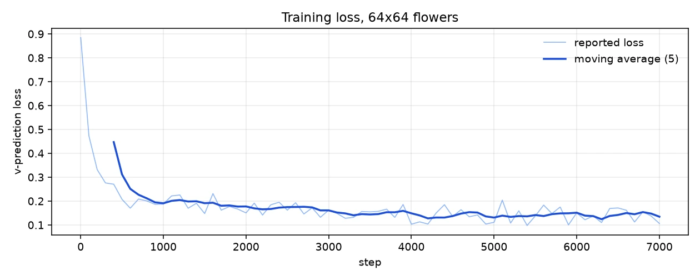
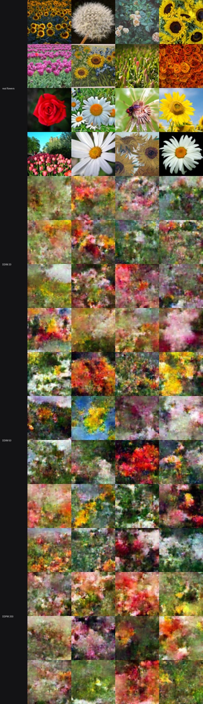
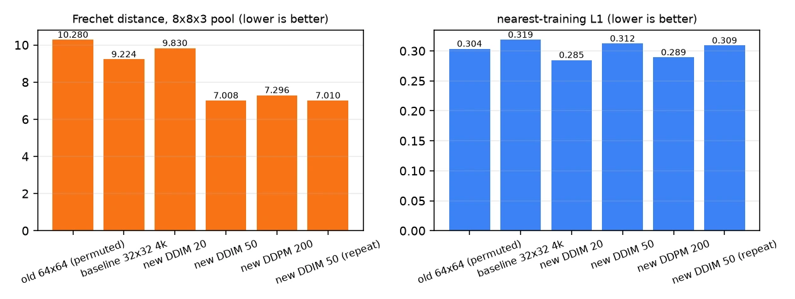
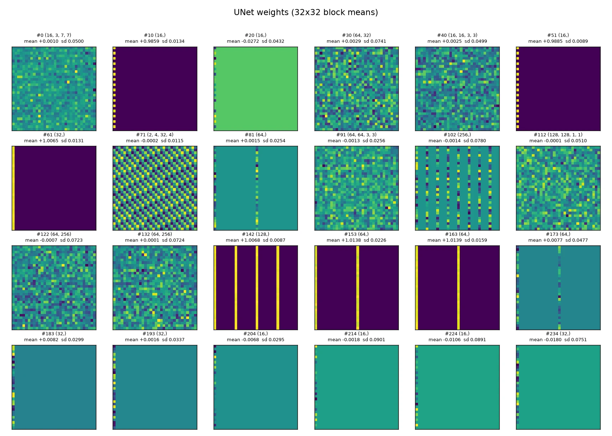
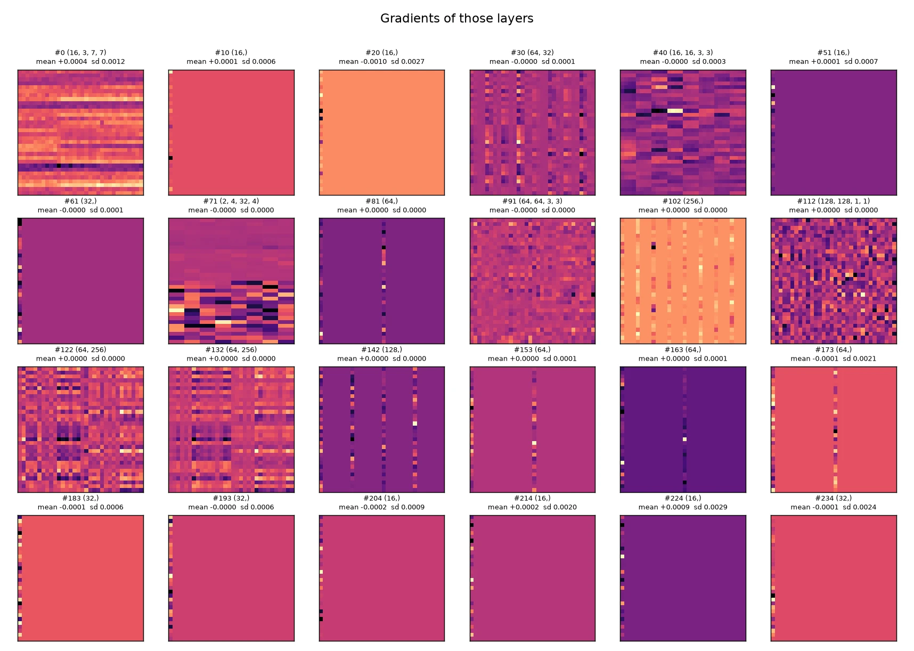
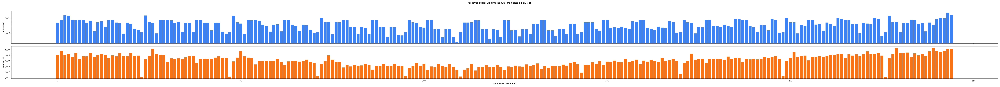

# diffusion

A port of [`lucidrains/denoising-diffusion-pytorch`](https://github.com/lucidrains/denoising-diffusion-pytorch)
(v2.3.4) to Burn: the reference's `Unet` and `GaussianDiffusion`, training loop,
EMA and DDIM sampler.

It exists as a second, independent Burn workload next to `glm53`. Where that port
is a language model, this one exercises convolution, residual blocks, attention
over a spatial grid, and the diffusion maths that FLUX-style models share.

## What is ported

| Reference | Here |
| --- | --- |
| `Unet` with `dim_mults`, RMSNorm, sinusoidal position embedding, `ResnetBlock` with time-conditioned scale/shift, linear and full attention with memory keys/values, pixel-unshuffle downsample, nearest upsample | `src/unet.rs` |
| `GaussianDiffusion`: linear, cosine and sigmoid beta schedules, `pred_noise` / `pred_x0` / `pred_v`, `q_sample`, `p_losses`, min-SNR loss weighting, DDPM `p_sample`, DDIM sampling | `src/diffusion.rs` |
| `ema_pytorch` in the trainer | `src/ema.rs` |
| `Dataset` over a folder of images | `src/data.rs`: synthetic shapes, plus a flat-file loader with a held-out split |

## Verification

`tests/parity.rs` compares against numbers extracted from the reference source
itself (`tests/data/schedules.json`), not against a retyped formula:

- all three beta schedules and their `alphas_cumprod`, to 1e-6;
- `q_sample` at t = 0, 7, 199, to 1e-6;
- the UNet preserves the image shape at a downsample factor of 4;
- DDIM sampling is deterministic when the device is seeded;
- one EMA blend step lands halfway between the shadow and the live weights.

One reference quirk is reproduced deliberately: it builds `v_start`/`v_end` with
`torch.tensor(...)`, which is f32, and then divides an f64 tensor by them. Doing
the same keeps the schedule buffers equal to the reference's.

## Results: ours against the reference, same data and budget

The reference has **no test suite** — no `tests/`, no `test_*` functions, no CI
workflow — so what can be run is its training and inference paths. Both were run
on the same eight shapes, the same architecture and the same budget.


| Run | Params | Train | DDIM 20 | DDPM 200 |
| --- | ---: | ---: | ---: | ---: |
| Untrained | — | — | 0.861 | — |
| Reference, 900 steps | 2,439,043 | 83 s | 0.136 (0.6 s) | **0.133** (5.2 s) |
| Ours, 900 steps | 2,439,043 | 193 s | 0.245 (1.1 s) | **0.188** (11.2 s) |
| Reference, 3000 steps | 2,439,043 | 407 s | 0.052 (0.7 s) | **0.0397** (9.2 s) |
| Ours, 3000 steps | 2,439,043 | 664 s | 0.076 (1.1 s) | **0.047** (11.7 s) |

Metric: mean L1 distance from a sample to the closest of the eight templates
(zero would be a perfect reproduction).

What this shows:

- **The architecture is right**: the parameter count matches the reference
  exactly, 2,439,043.
- **Both samplers work, in both implementations.** DDPM at 200 steps beats DDIM
  at 20 in every case (0.133 vs 0.136, 0.188 vs 0.245, 0.047 vs 0.076), which is
  the expected trade.
- **At equal steps the reference is still ahead, but by less over time.** At 900
  steps it is 0.133 against 0.188; at 3000 it is 0.0397 against 0.047, and the
  reference trains in 407 s against 664 s. The gap narrows rather than closing,
  which points at training dynamics — Burn's default initialisers differ from
  PyTorch's — rather than at a structural difference. The parameter count is
  identical, so the architecture is not the explanation.
- **Both reach recognisable shapes**: at 3000 steps a sample is within 0.047 mean
  absolute difference of a template, against 0.861 for an untrained model.

Reproduce with:

```sh
/tmp/glm-venv/bin/python scripts/ddpm_reference_run.py --steps 900
cargo run -p diffusion --release -- train --steps 900 --batch 16 \
    --image-size 16 --dim 16 --timesteps 200 --sampling-steps 20 --out artifacts/ddpm
cargo run -p diffusion --release -- sample --ckpt artifacts/ddpm --sampling-steps 200
```

## Flowers at 64x64: the loader fix, controlled

Two runs at exactly the same configuration, differing in one thing: the image
loader. The first copied interleaved RGB bytes into a `[3, H, W]` tensor, so the
network trained on a channel-interleaved permutation of every image while the
sample writer undid the permutation on display (`GLM-032`). The second uses the
corrected loader. Everything else is identical: 64x64, `dim 16`,
`dim_mults (1,2,4,8)`, batch 16, sigmoid schedule, 200 timesteps, v-prediction,
AdamW 2e-4, EMA 0.999, seed 11, 7,000 steps, 2,439,043 parameters.

### Data and held-out split

TensorFlow `flower_photos`, 3,670 images in five classes, centre-cropped to
64x64 and split **3,303 train / 367 held out** by file (seed 1234). The held-out
tenth is never trained on. The loader fix is verified before training by
rendering one batch: it shows flowers, and `tests/raw_images.rs` pins the plane
order with a 2x2 red/green/blue/white image.

### Training

| Run | Loader | Steps | Time | s/step | Loss, last step |
| --- | --- | ---: | ---: | ---: | ---: |
| A (recorded) | interleaved | 7,000 | 2,384.7 s | 0.34 | 0.154 |
| B (fixed) | planar | 7,000 | **1,063.0 s** | **0.15** | **0.106** |

Reducing the pixels to their correct positions made the data easier to fit: the
loss reaches 0.106 where A ended at 0.154. Run B took 17.7 minutes; run A's
0.34 s/step was measured while several builds and metric jobs shared the
machine. On an idle machine the same configuration measures 0.151 s/step, so an
hour now holds about **24,000 steps**, not 7,000.

Peak GPU memory during training: 3.4 GB (nvidia-smi, batch 16). Checkpoints
(live weights, EMA weights, config, progress) and a 16-image DDIM-20 grid every
1,000 steps; `--resume` continues from the recorded step.



### Samplers and metrics

256 samples per trajectory, EMA weights, held-out references. The Fréchet
distance is the same estimator as before: 8x8x3 pooled pixels, 192 dimensions.

| Model | Sampler | Steps | Time, 256 | Fréchet | nearest L1 | gradient ratio |
| --- | --- | ---: | ---: | ---: | ---: | ---: |
| baseline, 32x32, 4k | DDIM | 50 | 8.3 s | 9.224 | 0.319 | 1.353 |
| A, permuted loader | DDIM | 50 | 16.8 s | 10.280 | 0.304 | 1.308 |
| **B, fixed loader** | DDIM | 20 | 15.3 s | 9.830 | 0.285 | 0.868 |
| **B, fixed loader** | DDIM | 50 | 19.4 s | **7.008** | 0.312 | **0.983** |
| **B, fixed loader** | DDPM | 200 | 80.9 s | 7.296 | 0.289 | 0.894 |
| **B, fixed loader** | DDIM | 50, repeat | 19.8 s | 7.010 | 0.309 | 0.980 |

Held-out floors for reference: nearest L1 **0.329** at 64x64 (0.308 at 32x32);
gradient energy **0.231**, so a perfect gradient ratio is 1.0.

Recorded at the time, for the record and **not comparable** with the table above
(128 samples, rank-deficient estimator; run A also in permuted space):

| Recorded | Sampler | Fréchet | nearest L1 |
| --- | --- | ---: | ---: |
| A, permuted loader | DDIM 20 | 6.113 | 0.292 |
| A, permuted loader | DDIM 50 | 4.905 | 0.304 |
| A, permuted loader | DDPM 200 | 4.764 | 0.293 |
| A, repeat draw | DDPM 200 | 6.302 | 0.295 |
| baseline, 32x32 | DDIM 50 | 4.844 | 0.318 |





### Did the fix improve the model?

**Yes, clearly.** Fréchet 10.28 → 7.01 for the same sampler, steps and weights
budget, a 32% drop and 24% below the 32x32 baseline. The gradient ratio moved
from 1.31 (31% more high-frequency energy than real photos — the grain and
colour fringing of the old output) to 0.98, essentially matching the held-out
images. The repeat draw differs by 0.002, so the gap is not noise.

**And the samples finally read as flowers.** They are soft, close-up masses —
petal clusters, yellow centres, green foliage, a plausible sky — rather than the
smooth colour fields of run A. They are not photographic: there are no crisp
petal edges, and at 64x64 individual flowers are not resolved.

### A measurement correction

The earlier 128-sample numbers (DDIM 20 6.11, DDIM 50 4.91, DDPM 200 4.76, and
the repeat at 6.30) are **not comparable** with the table above, and the "±1.5
noise" read from them was wrong. With 128 samples and 192 pooled dimensions the
sample covariance has rank 127, the Fréchet matrix square root loses the null
space and the estimate swings by more than a unit between draws. The differences
in that table were dominated by the estimator, not the models.

At 256 samples the covariance is full rank: two DDIM-50 draws whose pixels
differ by a mean absolute 0.47 score 7.008 and 7.010. `scripts/ddpm_fidelity.py`
now refuses to compute the distance when samples <= dimensions. All numbers in
the table are 256-sample recomputations, including the old model and the
baseline, with the old raw dumps un-permuted to true image space first. That is
why the recorded 4.76 became 10.280 for run A: same model, correct space,
well-conditioned estimator.

### Weight and gradient heatmaps

`--dump` writes per-tensor shape, mean, sd, min, max, zero fraction and a 32x32
block mean, for weights and for the gradients of the last step.







| Group | Tensors | Weight sd | Gradient sd | A -> B |
| --- | ---: | ---: | ---: | --- |
| 1x1 convolutions | 31 | `8.0e-2` | `1.0e-3` | grad 6.3e-4 -> 1.0e-3 |
| 3x3 convolutions | 43 | `3.4e-2` | `4.7e-4` | grad 4.6e-4 -> 4.7e-4 |
| 7x7 stem | 1 | `5.0e-2` | `1.2e-3` | grad 2.6e-3 -> 1.2e-3 |
| linear (time MLP) | 21 | `7.8e-2` | `1.7e-4` | grad 1.4e-4 -> 1.7e-4 |
| norms and biases | 140 | `3.8e-2` | `1.3e-3` | grad 9.3e-4 -> 1.3e-3 |
| memory keys/values | 9 | `1.2e-2` | **`2.6e-7`** | grad 1.7e-7 -> 2.6e-7 |

- **245 tensors, every one with a non-zero gradient**; the smallest is
  `1.3e-7`, so nothing is disconnected or vanishing outright.
- Weight sd spans `2.7e-3` to `2.3e-1` (median `4.1e-2`); gradient sd `1.3e-7` to
  `2.4e-2` (median `1.7e-4`).
- The memory keys/values remain the quietest by three to four orders of
  magnitude; the correct data did not change that.
- Weight size still does not predict update size: `r = +0.39` between their logs.

### Verdict

**The fix worked and the samples now look like flowers** — soft, close-up flower
masses with petals, centres and foliage, not the colour fields of the previous
run. Fréchet fell from 10.28 to 7.01 and the texture energy matches real images
at 0.98 against 1.31. They are not photographic flowers, and 64x64 does not
resolve individual petals.

The binding limit is still steps. The corrected loader runs at 0.151 s/step, so
the same hour holds ~24,000 steps rather than 7,000; that is the experiment this
result argues for next.

## Usage

```sh
cargo run -p diffusion --release -- smoke                 # 120 steps, samples
cargo run -p diffusion --release -- train --steps 900 --image-size 16 --dim 16 \
    --timesteps 200 --sampling-steps 20 --out artifacts/ddpm
cargo run -p diffusion --release -- sample --ckpt artifacts/ddpm --samples 16
```

`--sampling-steps` below `--timesteps` switches `sample()` to DDIM; equal values
run the full DDPM chain.

For a real dataset:

```sh
python3 scripts/prepare_flowers.py --size 64 --holdout 0.1 \
    --out /tmp/flowers/train64.bin --holdout-out /tmp/flowers/held64.bin
cargo run -p diffusion --release -- train --backend wgpu \
    --data /tmp/flowers/train64.bin --eval-data /tmp/flowers/held64.bin \
    --image-size 64 --dim 16 --steps 7000 --batch 16 --timesteps 200 \
    --sampling-steps 20 --ema-decay 0.999 --checkpoint-every 1000 \
    --dump /tmp/run/dump.json --out /tmp/run
cargo run -p diffusion --release -- sample --backend wgpu --ckpt /tmp/run \
    --samples 128 --sampling-steps 50 --raw-out /tmp/run/ddim50.raw
python3 scripts/ddpm_fidelity.py --samples /tmp/run/ddim50.raw \
    --held /tmp/flowers/held64.bin --train /tmp/flowers/train64.bin --size 64
```

`--resume` restarts from the newest checkpoint. It restores the weights and the
step counter, **not** the AdamW moments: Burn's optimizer exposes no state, so a
resumed run continues with a fresh optimizer rather than replaying bit for bit.

## Deviations from the reference

- **Synthetic shapes by default, not CIFAR-10.** The reference trains on a folder
  of images through `torchvision`. Eight templates keep the example
  self-contained and make the closest-template metric meaningful; `--data`
  loads a packed image file when a real distribution is wanted.
- **No self-conditioning.** The reference has an optional second pass that feeds
  back the predicted `x0`; it is left out rather than half-implemented.
- **Memory keys and values are deterministic.** The reference draws them with
  `randn`; here they are a small fixed ramp. They are learnable either way.
- **No flash attention, no `accelerate`.** Full attention is a plain
  `softmax(q k^T / sqrt(d)) v`. Quality is measured with a nearest-training L1
  and a Frechet distance on 8x8x3-pooled pixels, not full-resolution FID: a
  12,288-dimensional covariance needs far more samples than one hour buys.
- **The EMA is a plain blend.** `ema_pytorch` supports warmup and per-parameter
  decay; the port keeps the part the training loop uses.
- **Resume restores weights, not optimizer state.** Burn's `AdamW` exposes no
  moments, so `--resume` continues with a fresh optimizer; see `GLM-030`.
- **wgpu can segfault, abort or hang at teardown.** It happens after every
  artefact is written, so `sample` and `train` flush stdout and exit without
  running the backend destructors (`GLM-034`). One sampling process hung for 20
  minutes before that was added.
- **The Frechet distance needs more samples than dimensions.** At 128 samples and
  192 dims the covariance is rank-deficient and the estimate moves by more than a
  unit between draws; `scripts/ddpm_fidelity.py` now refuses that combination and
  every number in this README uses 256 samples.
