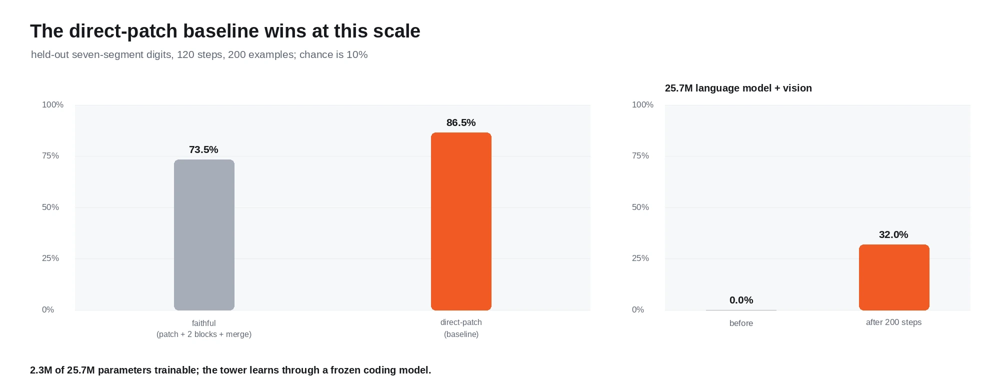
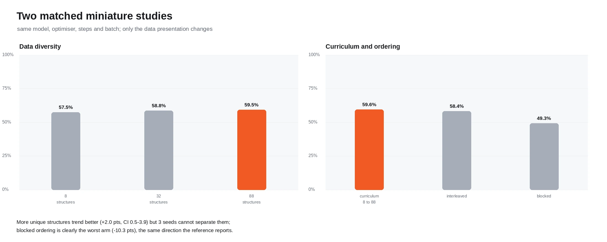

# glm53 — GLM-5.3-Flash-from-scratch, ported to Burn

A Burn reimplementation of
[`vukrosic/glm-5.3-flash-from-scratch`](https://github.com/vukrosic/glm-5.3-flash-from-scratch):
a 25.7M-parameter, GLM-5.3-Flash-inspired language model pretrained from random
initialization on a synthetic Python corpus, then post-trained with RLOO against
executable unit-test rewards.

## What is ported

| Component | Reference | Here | Notes |
| --- | --- | --- | --- |
| Parameters | 25,730,592 | **25,730,592** | Exact match |
| Active per token | 9,805,344 | **9,805,344** | Exact match |
| Layers | 12 | 12 | 9 linear + 3 sparse attention |
| Experts | 8, top-2, +1 shared | same | |
| Residual streams | 4 | 4 | |
| Tokenizer | byte-level, 260 tokens | same | |
| Evaluator | AST allowlist + executable tests | same | via a `python3` harness |
| Training | pretrain + RLOO | same | |
| Vision path | patch encoder + projector | not ported | see below |

```text
bytes -> embedding -> four residual streams
                       |
        [linear attention + MoE] x 3
                       |
        [sparse attention + MoE] x 1
                       |
                  repeat x 3
                       |
              RMSNorm -> tied LM head
```

## Verified

- **Parameter counts match the reference to the digit**, total and active. That
  only works if the architecture and the tied LM head are both correct.
- **The linear-attention reformulation is numerically checked** against a direct
  transcription of the reference's cumulative-sum definition, including the
  `elu(x) + 1` feature map.
- **Sparse and dense expert dispatch agree to 1e-5**, and only the routed experts
  receive gradient.
- **Gradients match finite differences** on sampled parameters. This is the check
  that matters most: a subtly wrong gradient still produces a falling loss curve.
- **Checkpoints round-trip**, both backends agree to 1e-4, and a fixed prompt is
  deterministic.
- **82 tests** across the library and the integration suite.

## Results

All figures on this port's own corpus and splits, so they are not the
reference's numbers. Dev is the split used for checkpoint selection; confirm was
opened once, for the final report only.

### Pretraining

400 steps, batch 16 x 128 tokens, AdamW, lr 3e-4, 155 s on an RTX 5060 via
wgpu/Vulkan. Loss 5.09 → 0.211.

### Checkpoint selection (dev, greedy pass@1)

| Checkpoint | dev pass@1 |
| --- | --- |
| 100 | 0.094 (3/32) |
| 200 | 0.906 (29/32) |
| 400 | **1.000 (32/32)** |

Dev saturates, exactly as the reference reports for its own benchmark.

### RL (RLOO, `last-block-head`, 32 groups x 8 rollouts, T=0.4, lr 5e-5)

RL starts from **checkpoint 200**, not 400. Two reasons, both measured:

- From checkpoint 100 every sampled rollout was invalid, so every group had zero
  reward spread and RLOO had nothing to learn from. Two runs (T=0.35 group 4,
  T=0.2 group 8) produced 30 and 32 no-signal groups respectively, and dev
  pass@1 stayed at 3/32.
- From checkpoint 400 dev is already 1.0, leaving no headroom to measure.

At checkpoint 200 the policy produces valid code with variation, which is what
RLOO needs.

| Metric | pre-RL | post-RL |
| --- | --- | --- |
| dev pass@1 | 0.906 (29/32) | **0.938 (30/32)** |
| dev pass@8 | 0.875 (28/32) | 0.875 (28/32) |
| dev exact rollouts | 0.812 | 0.781 |
| **confirm pass@1** | **0.906 (29/32)** | 0.844 (27/32) |
| **confirm pass@8** | **0.875 (28/32)** | 0.813 (26/32) |
| confirm exact rollouts | 0.816 | 0.785 |

**RL helped on the selection split and hurt on the held-out one.** One task
better on dev, two worse on confirm, at both pass@1 and pass@8. That is
overfitting to the tasks RLOO trained on, and it is the honest result: 32 groups
of binary reward on a 25M model is not enough to generalise, and the reference
reports the same pattern on its untrained families.

## Usage

```sh
# Parameter counts and the layer mix
cargo run -p glm53 --release -- params

# Pretrain, checkpointing along the way
cargo run -p glm53 --release -- train --steps 400 --batch-size 16 \
  --checkpoints 100,200,400 --out artifacts/glm53-run

# Pick the best checkpoint on dev
cargo run -p glm53 --release -- select --out artifacts/glm53-run --per-family 4

# Greedy pass@1 and sampled pass@k
cargo run -p glm53 --release -- evaluate \
  --ckpt artifacts/glm53-run/checkpoint-0200 --split dev --per-family 4
cargo run -p glm53 --release -- evaluate-passk \
  --ckpt artifacts/glm53-run/checkpoint-0200 --split dev --per-family 4 \
  --samples 8 --temperature 0.4

# RLOO
cargo run -p glm53 --release -- rl \
  --ckpt artifacts/glm53-run/checkpoint-0200 --out artifacts/glm53-rl \
  --groups 32 --group-size 8 --temperature 0.4 --learning-rate 5e-5 \
  --train-scope last-block-head --reward-mode binary
```

| Flag | Default | Meaning |
| --- | --- | --- |
| `--backend` | `wgpu` | `wgpu` (Vulkan) or `flex` (pure Rust CPU) |
| `--steps` | `400` | Pretraining steps |
| `--batch-size` | `16` | Dense expert dispatch caps this at 16 on a 6 GiB GPU |
| `--seq-len` | `128` | Sequence length |
| `--checkpoints` | — | Steps to checkpoint, e.g. `100,200,400` |
| `--split` | `dev` | `dev`, `final`, `confirm`, `rl` |
| `--per-family` | `4` | Tasks per family |
| `--samples` | `8` | Samples per task for pass@k |
| `--groups` / `--group-size` | `32` / `4` | RL budget |
| `--train-scope` | `last-block-head` | `all`, `last-block`, `last-block-head` |
| `--reward-mode` | `binary` | `binary` or `case-fraction` |

`--train-scope last-block-head` freezes everything except the last block, the
final norm and the embedding (which is also the tied head): **2,190,152 of
25,730,592 parameters** are trainable under RLOO.

## Vision

The image path is the reference's topology at teaching scale: RGB patches into two
non-causal vision blocks, a 2x2 spatial merge, and a gated projector that emits
language-model-width tokens. It appends ids 260/261/262, so it needs a 263-token
vocabulary; the text model is untouched, and a test proves the shared logits are
unchanged to 1e-5 after the vocabulary is widened.



At this scale the **direct-patch baseline wins**, 86.5% against 73.5% on held-out
digits. That is what the reference reports too (189/200 against 119/200), and it is
reported rather than tuned away: added structure did not pay for itself on a
60k-parameter budget.

The full-model pilot attaches the tower to the 25.7M language model and freezes
everything except the vision tower, the last block, the final norm and the tied
embedding — 2.3M of 25.7M parameters. It learns the digit task through a saturated
coding model, but 40 steps plateaued at chance (10%) and 200 steps reached 32%.

## The miniature studies

Two matched studies over an arithmetic corpus (add/sub/mul/neg/abs), each with a
~248k-parameter model, identical optimiser and step budget, and only the data
presentation changing.



Ten paired seeds, 200 steps, batch 24:

| Study | Result |
| --- | --- |
| Data diversity, 32 vs 8 structures | +3.8 points (95% CI +1.9 to +6.3), permutation p = 0.0039, Holm p = 0.0078 |
| Data diversity, 88 vs 8 structures | +1.7 points (95% CI -1.0 to +4.4), Holm p = 0.30 |
| Blocked vs curriculum ordering | -9.3 points (95% CI -11.4 to -7.0), p = 0.0020, Holm p = 0.0039 |
| Interleaved vs curriculum | -1.6 points (95% CI -3.3 to -0.03), Holm p = 0.10 |

Two effects survive Holm correction. The diversity gain is not monotonic: 88
structures (58.0%) is not separable from 8 (56.4%), so the reference's "more unique
data is better" holds only up to 32 here. Exact-expression accuracy was 0% in every
arm.

## RL variant screen and group-size confirmation

Eight arms from one checkpoint, one design choice changed at a time, 16 groups x 8
rollouts each, scored on 32 dev tasks:

| Arm | Groups with signal | Exact rollouts | Dev pass@1 |
| --- | --- | --- | --- |
| baseline (binary, -0.1, T=0.35, group 8) | 4/16 | 100/128 | 0.906 |
| partial-test reward | 4/16 | 100/128 | 0.906 |
| invalid penalty 0 | 1/16 | 100/128 | 0.906 |
| invalid penalty -1 | 3/16 | 100/128 | **0.938** |
| temperature 0.20 | 2/16 | 104/128 | **0.938** |
| temperature 0.80 | 1/16 | 0/128 | 0.906 |
| group size 4 | 2/16 | 50/64 | 0.906 |
| group size 16 | 4/16 | 200/256 | 0.906 |

The group arms see 64 and 256 rollouts respectively for the same 16 prompts, so
their exact counts are not comparable to the group-8 arms' 128.

Exact McNemar over paired dev tasks puts every arm at Holm p = 1.00: two arms move
one task, and one task out of 32 is noise. That is the same wall as before — the
policy sits above the capability band, so there is almost nothing for a design
choice to change.

**Group-size confirmation.** Group 4 against group 8 over three seeds and 12 groups
each:

| Seed | Group 4 | Group 8 | Difference | McNemar p |
| --- | --- | --- | --- | --- |
| 11 | 0.938 | 0.906 | -0.031 | 1.000 |
| 22 | 0.906 | 0.938 | +0.031 | 1.000 |
| 33 | 0.906 | 0.906 | 0.000 | 1.000 |

Seed mean +0.000, task-level 95% CI -0.031 to +0.031. Group 4 won one seed, lost
one and tied one — which is exactly the reference's own conclusion when its dev
winner failed to replicate.

## Receipts

Every checkpoint directory carries `config.json`, `metadata.json` and a sha256 of
its weights, and loading verifies the hash: a tampered file is a hard error.
`system-receipt` captures the OS, CPU, GPU, driver, toolchain and model config that
produced a result.

## Deviations from the reference

- **The evaluator shells out to `python3`.** The reference validates with a
  Python AST allowlist and then *executes* the candidate against unit tests. The
  port runs an embedded harness (`python3/evaluator_harness.py`) that mirrors
  `evaluator.py` exactly — same DENIED nodes, `SAFE_CALLS`, restricted builtins,
  2048-byte cap and strict `type(actual) is type(expected)`. Requests are batched
  so one interpreter start serves many candidates. The alternative was embedding
  a second Python runtime.
- **Sparse attention masks instead of gathering.** The reference gathers
  `k[b, h, indices[b, h, t, w], :]`, a rank-5 result that Burn's `gather` cannot
  produce. A gathered softmax over a selected set equals a masked softmax over
  all keys, so the port adds a `[1, 1, t, t]` additive mask. Same numbers,
  smaller intermediate.
- **The linear attention contracts instead of accumulating.** The reference
  materialises `kv[t] = sum_{s<=t} k_s (x) v_s` (rank 5 in Burn terms); the port
  masks a full contraction, which is the same quantity. Checked numerically.
- **Dense expert dispatch is the default.** The reference dispatches only the
  selected experts. Both are implemented and agree to 1e-5, but the sparse path
  is ~30x slower here because every expert sees a different row count and the
  JIT backend recompiles per shape. Sparse is what lets batch 32 fit; dense is
  what makes it fast.
- **The LM head reads the embedding weight directly.** Burn's module tree has no
  weight tying, so the head is `hidden @ embedding.weight.T` rather than a module.
  That is what makes the parameter count match.
- **The corpus generator is deterministic but not byte-identical.** Same eight
  families and prompt shape, a different PRNG.
- **Masked language-model loss is hand-rolled.** Burn's cross-entropy has no
  `ignore_index`, so the mask is applied to a gathered log-probability and the mean
  is taken over valid positions only.
- **Placeholder replacement is a splice, not a scatter.** The reference scatters
  visual embeddings into placeholder positions with `masked_scatter`; Burn has no
  equivalent, and the image span is always contiguous, so the port concatenates
  around it. Same result, no host round-trip.
- **The vision and experiment runs use `flex`, not `wgpu`.** wgpu took 58 s for two
  vision training steps where `flex` took 0.3 s: the tiny model presents many new
  shapes and the JIT backend recompiles instead of reusing kernels.
- **The arithmetic corpus and digit renderer use this crate's PRNG.** Same
  distributions, different bytes.

## Performance notes

| Stage | Wall clock | Peak GPU memory |
| --- | --- | --- |
| Pretrain 400 steps (wgpu) | 155 s | fits batch 16 |
| Vision comparison, 120 steps (flex) | 12.3 s | CPU |
| Vision smoke, 40 steps (flex) | 1.0 s | CPU |
| Vision pilot, 200 steps (flex) | 160.6 s | CPU |
| Data diversity, 30 arms (flex) | 123.2 s | CPU |
| Curriculum, 30 arms (flex) | 148.7 s | CPU |
| RL variant screen, 8 arms (wgpu) | 631.6 s | not sampled |
| Group confirmation, 6 runs (wgpu) | ~350 s | +489 MiB |
| RL, 96 groups (wgpu) | 282 s | +2725 MiB |


## Tests

```sh
cargo test -p glm53 --release
GLM53_WGPU_TEST=1 cargo test -p glm53 --release --test model_checks backends_agree
```

Covers the tokenizer, the corpus generator, both attention masks, the evaluator's
rejection rules, the linear-attention equivalence, generation determinism, the
MoE usage distribution, routed-only gradients, sparse-vs-dense dispatch, the
finite-difference gradient check, checkpoint round-trips and the cross-backend
differential.

## License

The port follows the reference's MIT license.
